# Dişli DC Motorlu Robot Kol: 180°'de Boşluk Yüzü Kestirimi

**Tek cümleyle:** Kol dik yukarıdayken (≈ 180°) dişli boşluğunun hangi yüzüne yaslandığı belirsizleşiyor. Bu çalışmada bu yüzü **kola sensör koymadan, yalnız motor akımı ve motor açısıyla** kestiren bir algoritma tasarlandı. Dijital ikizde 42 senaryonun hepsinde başarılı (basit yöntem 42'de 20), algoritma ESP32'de de çalışıyor.

<p align="center">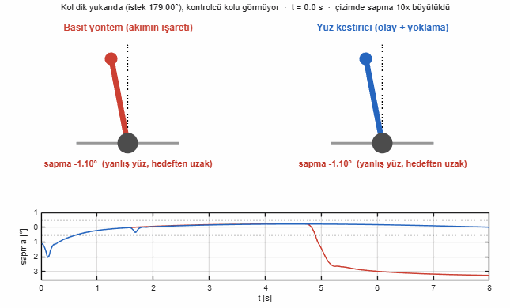</p>

<p align="center"><i>Kol 180°'de, iki yöntem aynı koşulda. Kırmızı: akımın işaretine bakan basit yöntem, 4,8 s'de yanlış yüze karar verip ≈ 3° sapıyor. Mavi: yüz kestirici hedefte kalıyor. Sapma çizimde 10 kat büyütüldü.</i></p>

| | |
|---|---|
| **Proje sayfası** | <https://safaksahinn.github.io/dc-motor-robot-arm/> |
| **Araştırma defteri** (tüm ayrıntı) | <https://safaksahinn.github.io/dc-motor-robot-arm/defter.html> |
| **Kendin çalıştır** | [aşağıda, 8. bölüm](#8-kendin-çalıştır-matlab) · tek komut: `sunum_demo` |
| **Durum (17 Kasım 2026)** | Algoritma dijital ikizde ve ESP32'de hazır; donanım siparişi sırada |

---

## Sunum akışı (≈ 5 dakika)

1. [Problem](#1-problem-dişli-boşluğu-ve-180) · 2. [Literatür](#2-literatür-ne-taradık-ne-bulduk) · 3. [Boşluk](#3-kapattığımız-boşluk) · 4. [Çözüm](#4-çözüm) · 5. [Sonuçlar](#5-sonuçlar) · 6. [Tasarımlar](#6-tasarımlar-matlab-simulink-simscape) · 7. [Sırada ne var](#7-riskler-ve-sonraki-adımlar) · 8. [Kendin çalıştır](#8-kendin-çalıştır-matlab) · 9. [Dosya yapısı](#9-dosya-yapısı)

---

## 1. Problem: dişli boşluğu ve 180°

Motor ile kol arasındaki dişlide ≈ 3° boşluk var. Motor yön değiştirdiğinde dişli bu boşluk kadar boşta döner; kol o sırada motoru izlemez. Bu bir **ölü bölge** doğrusalsızlığıdır.

Kol düşey düzlemde döndüğü için yerçekimi torku $mg\ell\sin\theta$ dişliyi sürekli bir yüze bastırır, yani doğal bir **ön gerilim** gibi davranır (AB sınıfı kuvvetlendiricide geçiş bozulmasını gideren ön gerilim gibi):

- **90° (kol yatay):** ön gerilim en büyük, kolun hangi yüzde durduğu belli.
- **180° (kol dik yukarı):** ön gerilim sıfır. Kol boşluğun iki ucundan birinde olabilir. Kontrolcü yanlış yüzü varsayarsa kol hedeften **≈ 3°** sapar.

<p align="center">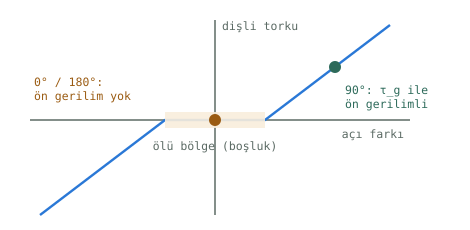</p>

<p align="center"><i>Dişlinin aktarım karakteristiği. Yerçekimi çalışma noktasını ölü bölgeden çıkarır (90°); 0° ve 180°'de çalışma noktası ölü bölgenin ortasında kalır.</i></p>

<details>
<summary><b>Boşluğun etkisi, 3B fiziksel modelde (animasyon)</b></summary>

<p align="center">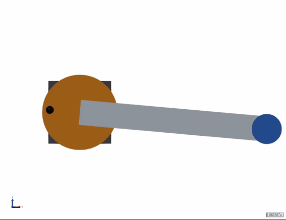</p>

<p align="center"><i>Simscape Multibody modeli, kol 90°'de: kontrolcü kol açısını geri beslerse boşluk sürekli bir salınım üretiyor (çevrim ≈ 142 ms). Bu, çalışmanın başlangıç sorusuydu; kontrolcünün yalnız motor tarafını görmesiyle bu salınım kayboluyor ve geriye 180°'deki yüz belirsizliği kalıyor.</i></p>
</details>

## 2. Literatür: ne taradık, ne bulduk

Beş turda tarandı: **yüzü aşkın sorgu, ≈ 50 makalenin tam metni** (danışman listesindeki 13 kaynak dahil). Her makaleye "ne yapmış, bizden farkı ne" notu düşüldü: [`literatur/okuma_notlari.md`](literatur/okuma_notlari.md).

| Tarih | Kaynak | Ne yapıldı |
|---|---|---|
| 18 Ekim | IEEE Xplore (kurum girişi) | 26 sorgu, 130 tekil makale. "Yerçekimi + boşluk + çalışma noktası" sorguları **0 sonuç** ([sorgular](literatur/ieee/ieee_sorgular_2026-10-18.md)) |
| 18 Ekim | OpenAlex, Semantic Scholar, Crossref, arXiv | IEEE dışı yayınevleri; boşluk derlemesi Nordin–Gutman 2002'ye atıf yapan 497 çalışma süzüldü ([özet](literatur/ieee_disi/tarama_ozeti_2026-10-18.md)) |
| 22 Ekim | Web of Science Core Collection | ≈ 12 sorgu, 45 kayıt tek tek incelendi ([özet](literatur/wos/wos_tarama_2026-10-22.md)) |
| 24 Ekim | OpenAlex + web | En yakın 8 makaleye atıf yapan 75 çalışma, 17 hedefli sorgu (13'ü 0 sonuç) ([özet](literatur/son_tarama_2026-10-24.md)) |
| 5 Kasım | IEEE, WoS, web, patentler | Seçilen çerçevenin kontrolü, 4 tur: IEEE 28, WoS 6, web 16 sorgu; ≈ 12 yeni tam metin ([özet](literatur/kontrol_taramasi/hedefli_tarama_2026-11-05.md)) |

Okunanlar dört gruba ayrılıyor ve aralarındaki bağ boşluğu gösteriyor:

<p align="center">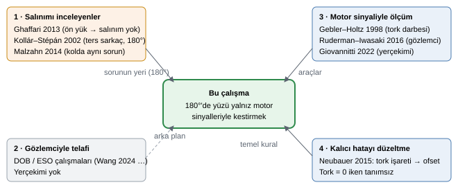</p>

| Grup | Ne yapıyor | Eksik kalan |
|---|---|---|
| **1 · Salınımı inceleyenler**: Ghaffari 2013 (TMECH), Kollár–Stépán 2002 (CDC), Malzahn 2014 | Ön yükün salınımı önlediğini; ters sarkaçta (180°) boşluğun salınım ürettiğini gösteriyor | Sorunu tarif ediyor, çözmüyor |
| **2 · Gözlemciyle telafi**: DOB / ESO çalışmaları (Wang 2024, LADOB 2023, Horng 2006) | Boşluğu bozucu gözlemcisiyle telafi ediyor | Yerçekimi yok |
| **3 · Motor sinyaliyle ölçüm**: Gebler–Holtz 1998 (IECON), Ruderman–Iwasaki 2016 (TIE), Giovannitti 2022 (JIM) | Kola sensör koymadan, tork darbesiyle ya da gözlemciyle boşluğu / dişli torkunu kestiriyor | Kolun hangi yüzde durduğunu kestirmiyor |
| **4 · Kalıcı hatayı düzeltme**: Neubauer 2015 (Mech. Sci.) | Motor torkunun işaretinden yüzü seçip hedefe ofset ekliyor | Tork = 0 iken (tam 180°'de) tanımsız |

**Bağlantı:** 4. grubun kuralı, 1. grubun sorunu gözlediği noktada (180°, tork ≈ 0) çalışmıyor.

## 3. Kapattığımız boşluk

> Kol dik yukarıdayken boşluğun hangi yüzüne yaslandığını **kola sensör koymadan, yalnız motor akımı ve motor açısıyla** bulan bir çalışma bulunamadı. Katkı bu.

Yeni bir parça icat edilmedi; bilinen parçalar birleştirildi: 3. gruptan **tork gözlemcisi** ve **küçük tork darbesi** fikri alınıp 4. grubun kuralının çalışmadığı noktaya uygulandı.

| Parça | Literatürde | Bu çalışmada |
|---|---|---|
| Motor tarafı döngü + açıya göre ofset tablosu | Yapılmış (Neubauer 2015) | Temel olarak kullanılıyor, katkı sayılmıyor |
| 180°'de yüz kestirimi, yalnız motor sinyalleriyle | **Doğrudan yapan yok** | **Ana katkı** |
| Boşluk ve dişli sertliğinin çevrim içi tanılanması | Kısmen yapılmış (Giovannitti 2022, Li 2026) | Kapsam dışı, bir kez ölçülüyor |

## 4. Çözüm

<p align="center">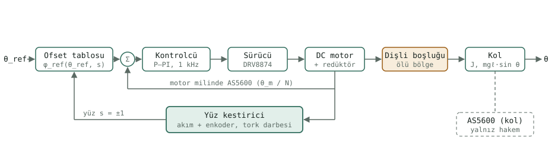</p>

<p align="center"><i>Yeşil blok katkı (yüz kestirici). Turuncu blok sorunun kaynağı. Kol açısı sensörü (kesik çizgi) kontrol döngüsünde yok, yalnız doğrulama için.</i></p>

Motorun gideceği açı: $\varphi_{ref} = \theta_{ref} + s \cdot r + mg\ell\sin\theta_{ref}/K_s$. Burada $s = \pm 1$ kolun yaslandığı yüz. 10–175°'de $s$ yerçekiminin işaretinden belli; 180° çevresinde yüz kestirici seçer:

1. **Olay yakalama:** kol boşluğun öbür yüzüne çarparsa bu çarpma motor torkunda iz bırakır; motor tarafı **tork gözlemcisi** bunu yakalar.
2. **Yoklama:** çarpma motoru kıpırdatmayacak kadar küçükse motora **küçük bir tork itişi** verilir ve kolun hangi yüzde olduğu yoklanır (yazılım benzetmesiyle: cevap gelmeyince gönderilen "ping").
3. **Yumuşak geçiş:** ofset yüz değişince basamakla değil rampayla değişir.

Tam 180° istekleri kolun geldiği tarafa göre 179,5° / 180,5°'ye kaydırılır: yüz kusursuz bilinse bile tam 180°'de yerçekimi işaret değiştirdiği için kol karşı yüze düşebiliyor (yöntemin sınırı).

## 5. Sonuçlar

| 42 / 42 | 3° → 0,2° | 0 / 114 | 4 µs |
|:---:|:---:|:---:|:---:|
| 180° çevresindeki senaryoların hepsi başarılı (basit yöntem: 42'de 20) | kol yanlış yüzde kaldığında kalıcı hata | açı × kazanç denemesinde boşluk salınımı (motor tarafı döngü) | algoritmanın ESP32'de bir adımı (1 kHz döngü) |

<p align="center">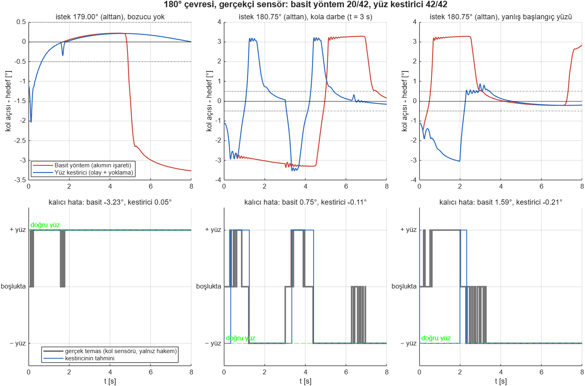</p>

<p align="center"><i><code>sunum_demo</code> çıktısı (gerçekçi koşul: motor milinde AS5600, 1 kHz, sensör gecikmesi ve gürültüsü, sürtünme). Üst: kol açısının hedeften sapması, kırmızı basit yöntem, mavi yüz kestirici, noktalı çizgiler ±0,5° başarı bandı. Alt: gri gerçek temas yüzü (kol sensöründen, yalnız hakem), mavi kestiricinin tahmini.</i></p>

| Yapılan | Elde edilen |
|---|---|
| Belirsiz bandın ölçülmesi | Kol yanlış yüze yalnız 180°'nin ±1°'si içinde düşüyor; orada kolu tutan tork sürtünmenin onda biri, bu yüzden akımın işaretine bakmak işe yaramıyor |
| Donanıma uygunluk | Motor arka miline AS5600 (kol tarafında 0,003°; motorun kendi enkoderi 0,27° yetmiyor); 1 kHz, sensör gecikmesi ve gürültüsü, INA228 akım gürültüsünün ≈ 20 katı, gerilim sürüşü: hepsinde 42/42 |
| Dayanıklılık | Yük ve dişli sertliği ±%20, boşluk ±%10, sürtünme ×0,5–1,5 tek başına sonucu değiştirmiyor |
| Doğrulama | Dijital ikiz Simscape fiziksel modeliyle karşılaştırıldı; algoritma C'ye çevrildi, ESP32'de MATLAB'la 84 senaryoda birebir aynı kararlar; ikizin kendisi kartta gerçek zamanlı koştu (döngü bütçesinin %19'u) |
| Deney protokolleri | Tanılama (D0–D5), salınım sınırı (D6), 180° deneyi (D7: 42 senaryo × 3, basit yöntemle karşılaştırmalı) yazıldı: [`calisma_notu/deney_protokolu.md`](calisma_notu/deney_protokolu.md) |

**Bütün sonuçlar dijital ikizden; donanım henüz sipariş edilmedi.**

## 6. Tasarımlar: MATLAB, Simulink, Simscape

Dijital ikiz dört ayrı modelle kuruldu ve birbiriyle karşılaştırıldı: MATLAB betiği (`kol_benzetim.m`), Simulink blok modeli, Simscape fiziksel modeli (elektrik tarafıyla birlikte) ve Simscape Multibody 3B modeli. Her görselin altında MATLAB'da nasıl açılacağı yazıyor (komutlar `simulasyon/simulink` klasöründe).

### 6.1 Mekanik yapı (Simscape Multibody, 3B)

<p align="center">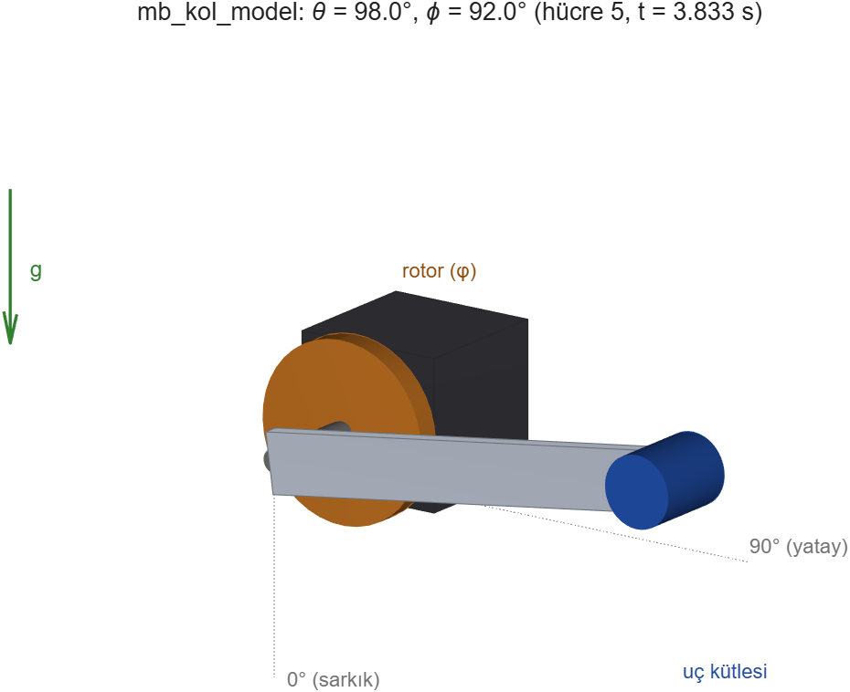</p>

<p align="center"><i>Motor gövdesi, rotor (motor açısı φ), 15 cm kol ve uç kütlesi; yerçekimi aşağı. Açı tanımı: 0° kol sarkık, 90° yatay, 180° dik yukarı. Dişli boşluğu rotor ile kol eklemi arasında.</i></p>

<p align="center">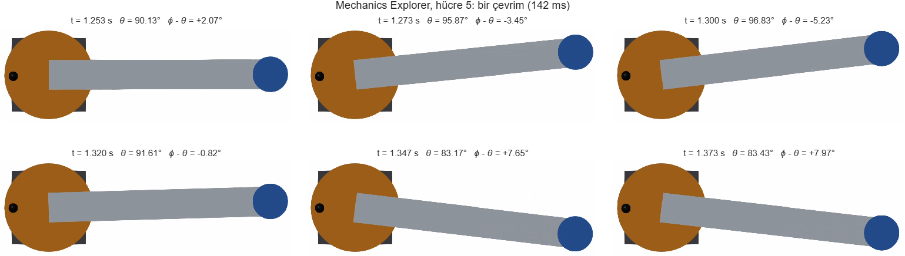</p>

<p align="center"><i>Mechanics Explorer'dan bir salınım çevrimi (142 ms). Başlıklardaki φ − θ dişli boşluğunun içindeki konum: kol boşluğun iki yüzü arasında gidip geliyor.</i></p>

**MATLAB'da:** `open('mb_kol_model.slx')` blok şemayı açar. 3B koşu için arayüzlü MATLAB'da `mb_animasyon(5)` (Mechanics Explorer açılır; `rapor/img/mb_animasyon.mp4` ve `mb_me_kareler.png` dosyalarını yeniden yazar).

<details>
<summary><b>Multibody modelinin blok şeması</b></summary>

<p align="center">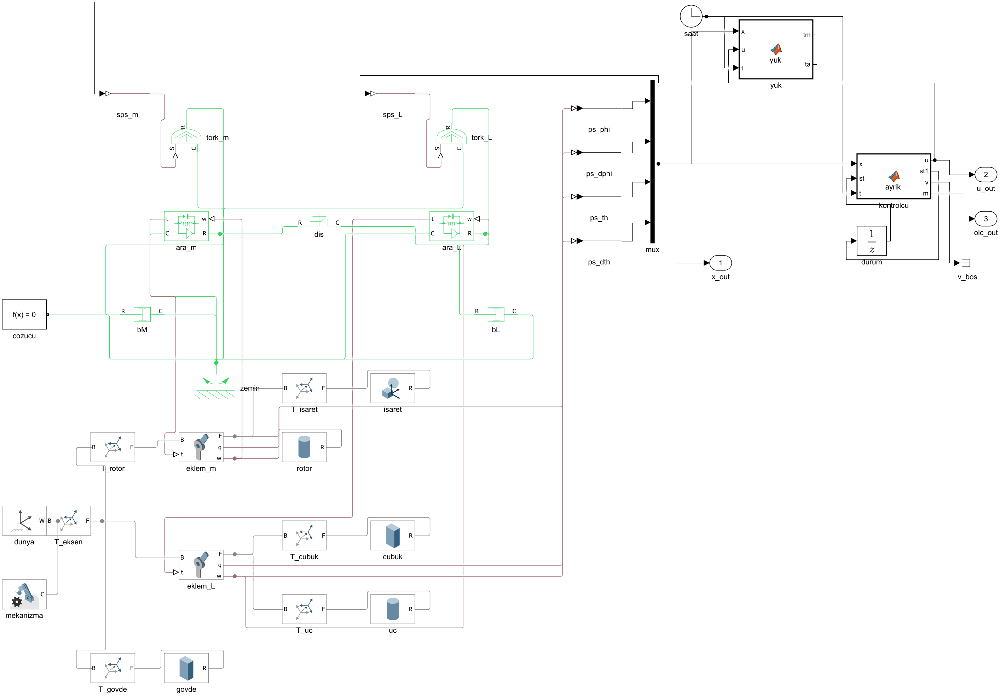</p>

<p align="center"><i>Alt kısım 3B mekanizma: dünya çerçevesi, iki döner eklem (eklem_m: rotor, eklem_L: kol), rotor diski, kol çubuğu, uç kütlesi, gövde. Ortada yeşil 1B mekanik ağ: dişli boşluğu (dis), sönümler (bM, bL), tork kaynakları; ara_m / ara_L iki dünyayı bağlıyor. Sağ üstte kontrolcü (ayrık zamanlı, sensör modeliyle) ve yük bloğu.</i></p>
</details>

### 6.2 Fiziksel model (Simscape)

<p align="center">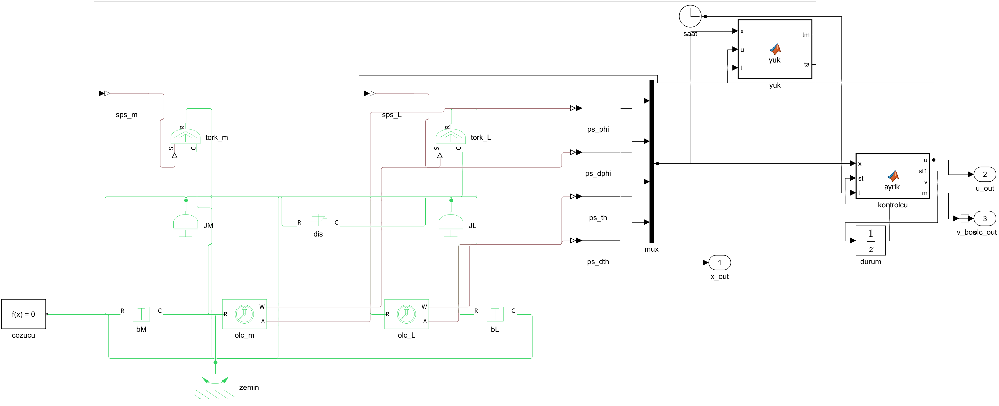</p>

<p align="center"><i>Yeşil çizgiler mekanik bağlantılar: JM motor rotoru, <b>dis</b> dişli boşluğu (sert durdurucu: boşluk + dişli sertliği + temas sönümü), JL kol, bM / bL sürtünme ve sönüm, olc_m / olc_L açı ölçerler. Sağda kontrolcü ve yük (yerçekimi torku) blokları.</i></p>

**MATLAB'da:** `open('sm_kol_model.slx')`

### 6.3 Elektrik tarafı (Simscape, gerilim sürüşü)

<p align="center">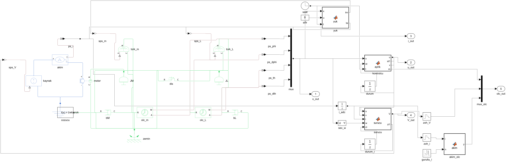</p>

<p align="center"><i>Aynı model, motorun elektrik devresiyle: mavi çizgiler elektrik (kaynak → akım ölçer → DC motor: sargı direnci, endüktans, zıt EMK). Sağ altta sürücü (DRV8874 akım sınırıyla gerilim sürüşü) ve gürültülü akım ölçümü (INA228 modeli). Deneylerin yapılacağı gerilim sürüşü kararı bu modelle verildi.</i></p>

**MATLAB'da:** `open('sm_motor_model.slx')`

### 6.4 Blok modeli (Simulink)

<p align="center">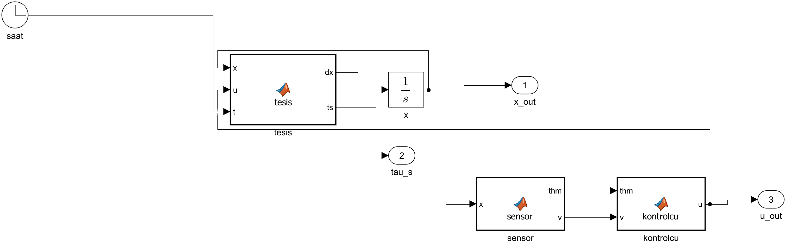</p>

<p align="center"><i>Tesis (iki kütle + boşluk + yerçekimi), sensör (nicemleme, gecikme, gürültü) ve kontrolcü ayrı bloklar. Betikle aynı denklemleri ve aynı çözücüyü kullanıyor.</i></p>

**MATLAB'da:** `open('kol_model.slx')`

### 6.5 Modeller birbirini doğruluyor

<p align="center">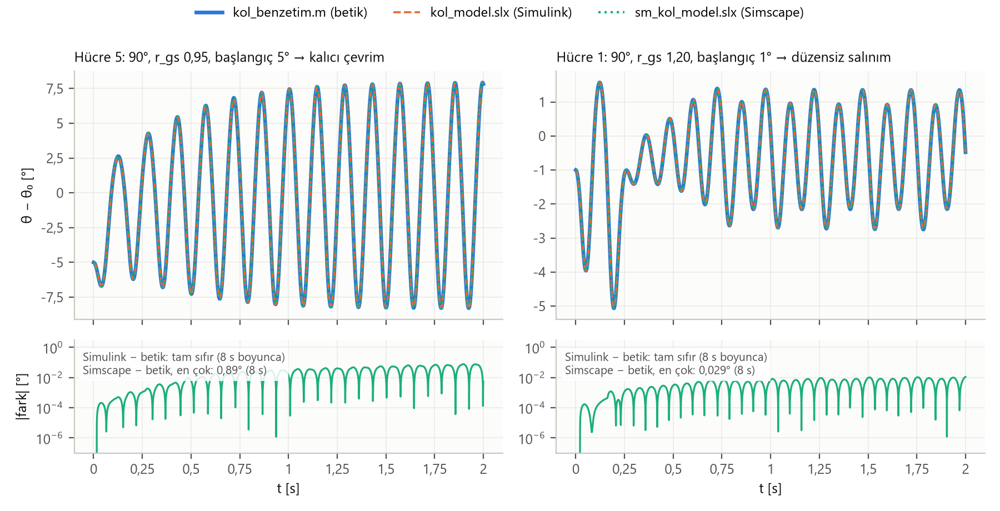</p>

<p align="center"><i>Aynı iki koşulda betik, Simulink ve Simscape eğrileri üst üste. Alt satır farkı gösteriyor: Simulink − betik tam sıfır, Simscape − betik en çok 0,89° (8 s sonunda, kalıcı salınımda) ve 0,029°.</i></p>

### 6.6 İkizde sanal deney: dişli sertliğinin ölçülmesi (D3)

<p align="center">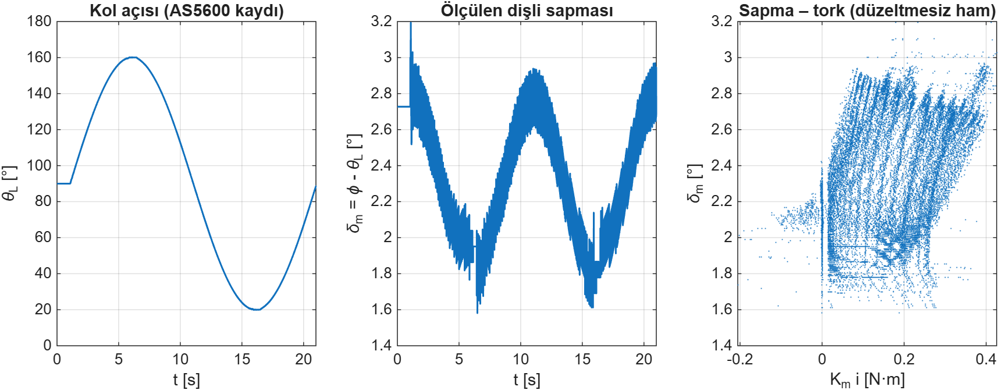</p>

<p align="center"><i>Donanımda yapılacak D3 tanılama deneyi ikizde koşuldu: kol 20–160° arasında yavaşça taranıyor, yerçekimi torku değiştikçe dişli sapması (φ − θ) değişiyor. Sapma–tork ilişkisinin eğiminden dişli sertliği, kaymasından boşluk çıkıyor; gerçekçi sensörle dişli sertliği ≈ %1 hatayla bulunuyor. Diğer tanılama deneyleri (D2 sürtünme, D4 boşluk, D5 temas sönümü) aynı biçimde sınandı: <code>rapor/img/D2_Fs.png</code>, <code>D4_r.png</code>, <code>D5_cs.png</code>.</i></p>

### 6.7 Donanım mimarisi

<p align="center">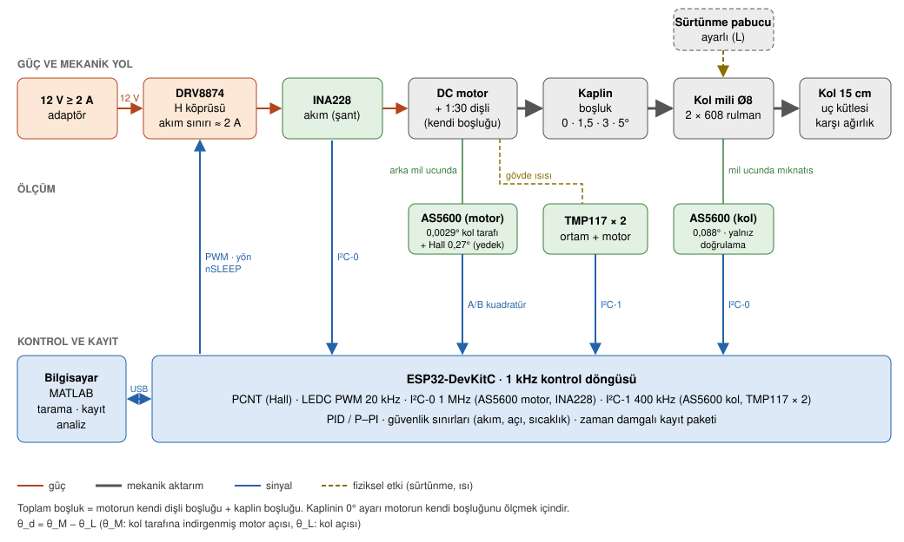</p>

<p align="center"><i>Üst sıra güç ve mekanik yol (adaptör → DRV8874 → INA228 → motor → boşluk kaplini → kol mili → kol). Orta sıra ölçüm: motor arka milinde AS5600 (kontrolcünün gördüğü), TMP117 sıcaklık, kol milinde AS5600 (yalnız doğrulama). Alt sıra ESP32 1 kHz kontrol döngüsü ve bilgisayar.</i></p>

## 7. Riskler ve sonraki adımlar

**Riskler**
- Birkaç model hatası aynı anda büyükse pay daralıyor (ikizde 42'de 37–42). Aday önlem: yoklama itişini ölçülen sürtünmeye göre ayarlamak (henüz sınanmadı).
- Tam 180° düzelmiyor; yöntem ±0,5–1° bandını düzeltiyor. Yöntemin sınırı olarak yazılacak.

**Sonraki adımlar**
1. **Sipariş** (≈ 3.500–6.100 TL + ≈ 70 $, gövde seçeneğine göre): [`calisma_notu/malzeme.md`](calisma_notu/malzeme.md)
2. **Parçalar yoldayken:** 3B mekanik tasarım (boşluk kaplini, sensör tutucuları, kilit pimi, durdurucular); sensör (2 × AS5600, INA228, TMP117) ve sürücü (DRV8874) kodu
3. **Deneyler:** D0 kalibrasyon → D1–D5 tanılama → D6 salınım sınırı → **D7 180° deneyi (katkının kanıtı)**
4. **Sonra:** deney–ikiz karşılaştırması; hedef IEEE/ASME TMECH ya da IEEE TIE düzeyinde dergi makalesi

---

## 8. Kendin çalıştır (MATLAB)

**Gereken:** MATLAB (R2026b ile denendi). `sunum_demo` ve `sunum_animasyon` için ek araç kutusu gerekmez. Simulink modellerini açmak için Simulink + Simscape (+ Simscape Multibody) gerekir.

### Adım 1: Repoyu indir

- **ZIP ile:** bu sayfanın üstündeki yeşil **Code** düğmesi → **Download ZIP** → ZIP'i aç. Klasörün adı `dc-motor-robot-arm-main` olur.
- **Git ile:**
  ```bash
  git clone https://github.com/SafakSahinn/dc-motor-robot-arm.git
  ```

### Adım 2: MATLAB'da çalıştır

Komut penceresine (yolu kendi indirdiğin yere göre değiştir; örnek: ZIP İndirilenler klasörüne açıldıysa):

```matlab
cd(fullfile(getenv('USERPROFILE'), 'Downloads', 'dc-motor-robot-arm-main', 'simulasyon', '5_planlama'))
sunum_demo
```

> **Windows notu:** "Tümünü ayıkla" ZIP'i çoğu zaman iç içe iki klasöre açar (`dc-motor-robot-arm-main\dc-motor-robot-arm-main\...`). `cd` hata verirse şunu kullan:
> ```matlab
> cd(fullfile(getenv('USERPROFILE'), 'Downloads', 'dc-motor-robot-arm-main', 'dc-motor-robot-arm-main', 'simulasyon', '5_planlama'))
> ```

Ya da MATLAB'ın sol tarafındaki **Current Folder** panelinde `simulasyon/5_planlama` klasörüne gidip `sunum_demo` yaz. Doğru klasörde olduğunu `ls sunum_demo.m` ile kontrol edebilirsin.

**Beklenen çıktı** (≈ 10 sn, her yöntem ≈ 3 sn):

```text
=== Yüz kestirici gösterimi: 42 senaryo, AS5600 + 1 kHz + gecikme + gürültü, sürtünmeli ikiz
  Basit yöntem (akımın işareti)    : 20 / 42 senaryo geçti   (en kötü kalıcı hata 3.24°, 3 s)
  Yüz kestirici (olay + yoklama)   : 42 / 42 senaryo geçti   (en kötü kalıcı hata 0.21°, 3 s)
  Ölçüt (H7): son 1 s ortalama |hata| <= 0,5°, en büyük <= 1°, kol doğru yüzde.
```

ve [5. bölümdeki](#5-sonuçlar) 6 grafikli şekil açılır.

### Sunumda açılabilecek diğer dosyalar

| Ne | Dosya | Nasıl |
|---|---|---|
| Canlı gösterim (yukarıda) | [`simulasyon/5_planlama/sunum_demo.m`](simulasyon/5_planlama/sunum_demo.m) | `sunum_demo` |
| README görsellerini yeniden üret | [`simulasyon/5_planlama/sunum_animasyon.m`](simulasyon/5_planlama/sunum_animasyon.m) | `sunum_animasyon` (≈ 1 dk; `sunum/img/` üzerine yazar) |
| Simscape fiziksel modeli | [`simulasyon/simulink/sm_kol_model.slx`](simulasyon/simulink/sm_kol_model.slx) | `open('../simulink/sm_kol_model.slx')` (yalnız göster) |
| Elektrik taraflı model (gerilim sürüşü) | [`simulasyon/simulink/sm_motor_model.slx`](simulasyon/simulink/sm_motor_model.slx) | `open('../simulink/sm_motor_model.slx')` |
| Dijital ikizin çekirdeği | [`simulasyon/kol_benzetim.m`](simulasyon/kol_benzetim.m) | `edit ../kol_benzetim.m` |
| Ayrıntılı sonuç logları | [`yuz_kestirici_as5600_log.txt`](simulasyon/5_planlama/yuz_kestirici_as5600_log.txt) · [`mod1_kestirici_log.txt`](simulasyon/5_planlama/mod1_kestirici_log.txt) · [`dogrula_elk_log.txt`](simulasyon/simulink/dogrula_elk_log.txt) | GitHub'da tıkla ya da `edit` |
| ESP32 C kodu | [`firmware/src/kontrol.cpp`](firmware/src/kontrol.cpp) | kontrolcü, gözlemci, yüz kestirici |

> **Not:** `belirsiz_bant`, `yuz_kestirici`, `mod1_kestirici`, `dogrula_elk` gibi asıl araştırma betikleri uzun sürer ve log dosyalarının üstüne yazar. Gösterim için yalnız `sunum_demo` kullan; o hiçbir dosya yazmaz.

## 9. Dosya yapısı

```
dc-motor-robot-arm/
├── README.md                    # bu sayfa (sunum)
├── sunum/img/                   # README görselleri (sunum_animasyon.m üretir)
├── simulasyon/
│   ├── kol_benzetim.m           # dijital ikiz: iki kütle + boşluk + yerçekimi + kontrol + sensörler
│   ├── 4a_ghaffari/             # literatür sonucunun yeniden üretimi, düzenek seçenekleri (secenek_duzenek.m)
│   ├── 5_planlama/              # yüz kestirici: belirsiz bant, üst sınır, kestirici, duyarlılık, mod 1
│   │   ├── sunum_demo.m         # ← canlı gösterim
│   │   └── sunum_animasyon.m    # ← README görselleri
│   ├── 6_esp32/                 # ESP32 ile MATLAB arasındaki seri protokol ve kart üstü doğrulama
│   └── simulink/                # Simulink / Simscape modelleri ve doğrulama betikleri
├── firmware/src/                # ESP32 C++ kodu (kontrolcü, gözlemci, yüz kestirici, protokol)
├── calisma_notu/                # çerçeve, deney protokolü, malzeme, mimari
├── literatur/                   # sorgu listeleri, tarama özetleri, okuma notları
├── donanim/                     # alışveriş listesi, tasarım kararları
├── rapor/                       # 4. adım raporu (PDF) ve görselleri
├── site/ → docs/                # proje sayfası ve araştırma defteri (GitHub Pages)
├── matlab/, sekiller/, latex/   # temel model (aşağıda, Ek)
```

---

## Ek A: İlk çerçeve (arşiv, 18 Ekim – 5 Kasım 2026)

<details>
<summary>İlk araştırma sorusu, ilk literatür özeti, salınım haritası ve donanım karşılaştırması (güncel çerçeveden önce)</summary>

> Bu bölüm kontrolcünün kol açısını gördüğü önceki çerçeveye ait. Motor tarafı döngüyle boşluk salınımı ortadan kalkınca çalışma 180°'deki yüz belirsizliğine yeniden çerçevelendi (5 Kasım 2026). Geri dönüş noktası olarak duruyor.

### A.1 Araştırma sorusu

Ucuz dişli motorlarda dişliler arasında bir boşluk vardır. Konum kontrolünde bu boşluk, kolun hedef etrafında durmadan salınmasına (limit cycle) yol açabilir. Literatürde bu konu geniş biçimde çalışılmış, ama neredeyse her zaman **yatay** düzeneklerde: iki kütleli tahrikler, takım tezgâhları, döner tablalar.

Düşey düzlemde çalışan bir kolda durum farklıdır. Yerçekimi torku $mg\ell\sin\theta_0$ dişliyi sürekli bir kenara bastırır:

- **90° (yatay):** yerçekimi torku en büyük, dişli bastırılı.
- **0° (aşağı) ve 180° (yukarı):** yerçekimi torku sıfır, boşluk tamamen etkin.

**Hipotez.** Boşluk, dişlinin ilettiği tork sıfırdan geçtiğinde devreye girer. Kolda bu tork, sabit yerçekimi torku ile salınımlı dinamik torkun toplamıdır. Yerçekimi bu sıfır geçişlerini açıya göre engeller ya da serbest bırakır. Dolayısıyla boşluk kaynaklı salınımın var olup olmadığı **çalışma açısı ile kontrolcü kazancının birlikte** belirlediği bir haritaya göre değişir.

**Hedeflenen katkılar (güncel, 5 Kasım 2026 akşam):**
- **Temel (bilinen, anılır):** kol sensörsüz motor tarafı konum döngüsü + açıya göre ofset tablosu ($\varphi_{ref} = \theta_{ref} + s \cdot r + mg\ell\sin\theta_{ref}/K_s$; Neubauer ve ark. 2015). Dijital ikizde 0–180°'de boşluk salınımı yok, 10–175°'de kalıcı hata ≤ 0,27°.
- **Ana katkı:** 180° çevresinde, yerçekimi ön yükü sıfıra inince kolun boşluğun hangi yüzüne yaslandığını ($s$) **yalnız motor akımı ve enkoderle** kestirmek (tork gözlemcisi + küçük tork darbesiyle aktif yoklama). Belirsiz bandın tanımı ve gözlenebilirlik sınırı dahil.
- **Uygulama:** ESP32 üzerinde 1 kHz gömülü gerçekleme.
- **Kapsam dışı:** $r$ ve $K_s$'nin çevrim içi tanılanması (bir kez, bilinen yöntemle ölçülür). Sürtünme kaynaklı yapışma–kayma salınımı için ayrı bir katman (integratör ölü bandı; Armstrong ve Amin 1996).
- Önceki çerçeve (açıya göre kazanç ve gözlemci planlaması, kol sensörlü) geri dönüş noktası olarak `calisma_notu/framing.md` 0. bölümde duruyor.

**İlk çerçevedeki katkılar (analiz, artık ana katkının aracı):**
- Yerçekimsiz sistemlerde "sabit referans limit cycle'ı yalnızca kaydırır" sonucunun (Esbrook, Tan, Khalil 2014) yerçekimli kolda geçerli olmadığını göstermek.
- Açı–kazanç düzleminde nicel bir harita ve kaymalı (bias) tanımlama fonksiyonuyla analitik açıklama.
- Açıya göre ayarlanan bir bozucu gözlemci.
- Erişilebilir bir düzenekte (dişli DC motor, ESP32, manyetik açı sensörü, 20 bit akım ölçümü) deneysel doğrulama; ortam ve motor sıcaklığı her deneyle birlikte kaydedilir.

### A.2 Literatür

- IEEE Xplore'da 26 sorgu (130 sonuç), IEEE dışında OpenAlex ile başlık+özet araması, Web of Science Core Collection'da 12 sorgu (44 kayıt) ve en yakın makalelere atıf yapan çalışmaların taranması.
- 37 makalenin tam metni okundu. Notlar: [`literatur/okuma_notlari.md`](literatur/okuma_notlari.md); tarama özetleri: [`literatur/ieee_disi/tarama_ozeti_2026-10-18.md`](literatur/ieee_disi/tarama_ozeti_2026-10-18.md), [`literatur/wos/wos_tarama_2026-10-22.md`](literatur/wos/wos_tarama_2026-10-22.md).
- Belirleyici sorgu "boşluk + yerçekimi + tanımlama fonksiyonu": OpenAlex'te ve Web of Science'ta **0 sonuç**.
- En yakın çalışma Sun ve ark. (2023, IEEE TIE). Düşey düzlemde salınan bir kolu modelliyorlar ($M_L\sin\theta_L$ terimiyle) ve 90°'de yüksek kazançta salınım gözlüyorlar. Ama yerçekiminin etkisini incelemiyorlar ve tek bir açıda çalışıyorlar.
- "Yerçekimi dişliye ön yük gibi davranır" fikri, endüstriyel robotlarda statik boşluk telafisi için biliniyor (Ahmad 1985; Karim ve ark. 2018). 7 eksenli D-Arm kolunda, bağ dik konumdan geçerken yerçekimi torkunun yön değiştirip dişliyi karşı yüze çarptırdığı gözlenmiş (Xu ve ark. 2023, IEEE RA-L), ama analiz edilmemiş. Kapalı çevrim kararlılığına bağlanmamış.

### A.3 Simülasyon bulguları

İki kütleli model kuruldu: motor ve kol, arada dişli sertliği ve boşluk; kolda yerçekimi; PID kontrol. Üç model seviyesinde çalışıldı: ideal; Coulomb ve yapışma sürtünmeli; gerçekçi (12 bit açı sensörü, enkoder nicemlemesi, 1 kHz kontrol, sürücü ölü bandı). Kod: [`simulasyon/`](simulasyon/), ayrıntılı sonuçlar: [`simulasyon/sonuclar_2026-10-18.md`](simulasyon/sonuclar_2026-10-18.md).

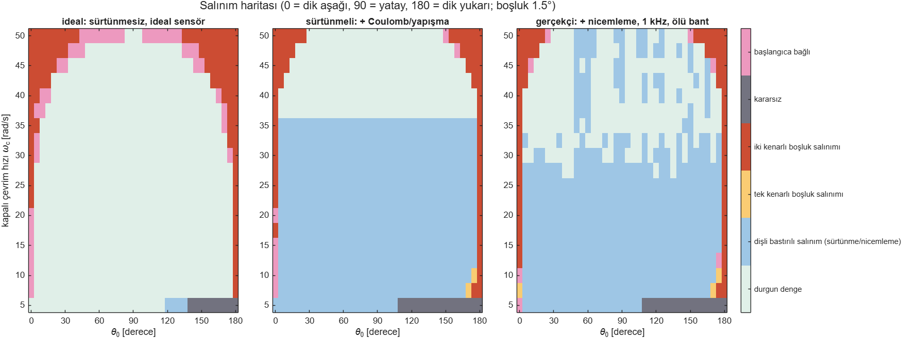

*Açı × kapalı çevrim hızı haritası. Kırmızı: dişlinin iki kenarı arasında gidip geldiği boşluk salınımı. Mavi: dişli bastırılıyken oluşan sürtünme/nicemleme salınımı.*

1. **Sönüm motor tarafından alınmalı.** Türev terimi kol hızından alınınca, boşluk olmasa bile döngü dişli rezonansında kararsızlaşıyor. Motor enkoderinden alınınca kararlı kalıyor.
2. **Hipotez benzetimde görülüyor.** Boşluk salınımı 0° ve 180° civarında toplanıyor; 90° etrafında salınımsız bir bölge var ve bu bölge kazanç arttıkça daralıyor.
3. **Sürtünme açıdan bağımsız ikinci bir salınım yaratıyor**, ama bu sırada dişli bastırılı kalıyor. Boşluğu sürtünmeden ayıran ölçüm, motor açısı ile kol açısı arasındaki farktır ($\theta_d$). Bu yüzden iki açı sensörü gerekiyor.
4. **En güçlü deney değişkeni boşluk genişliği.** Boşluk 1,5°'den 3°'ye ve 5°'ye çıkınca salınım bandı belirgin biçimde genişliyor.
5. **Sonuçlar boyutsuz bir haritada toplanıyor.** İki boyutsuz sayı kullanılıyor: $\gamma = mg\ell\sin\theta_0/(K_s r)$ (yerçekimi torkunun, boşluğu kapatan dişli torkuna oranı) ve $r_s = \omega_c/\omega_{rez}$ (kontrolcü hızının dişli rezonans frekansına oranı). 24 farklı düzenek aynı şeride düşüyor; ideal modelde yaklaşık $\gamma_{sınır} \approx 3\,r_s^3$. Gerçekçi modelde bu ilişki $r_s \approx 0{,}23$–$0{,}38$ aralığında korunuyor.

<p align="center">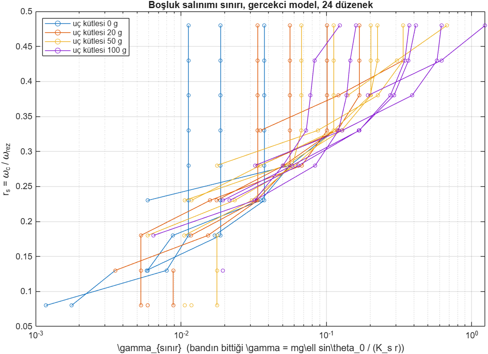</p>

### A.4 Donanım

Malzeme üç düzeyde değerlendirildi: en ucuz ilk liste, maxon motorlu üst sınıf liste ve ikisinin arasındaki **dengeli liste (seçilen)**. Motor ilk listedeki gibi kaldı; ucuz ama kritik parçalar bilinen üreticilerden alındı.

| Görev | 1. İlk liste | **2. Dengeli liste (seçilen)** | 3. Üst sınıf |
|---|---|---|---|
| Motor + enkoder | JGB37-520 1:30, 639 TL | **JGB37-520 1:30, 639 TL** (ya da enkoderli JGA25-370) | maxon DCX 22 L + GPX 22 LZ 26:1 + ENX 16, ≈ 472 € |
| Sürücü | TB6612FNG, 81 TL | **TI DRV8874 (Pololu #4035), 11,94 $** | DRV8874 × 2 |
| Denetleyici | genel ESP32, ≈ 270 TL | **Espressif ESP32-DevKitC, ≈ 13 €** | aynı |
| Motor açısı (ince) + kol açısı | AS5600 modülü × 2, ≈ 516 TL | **Adafruit AS5600 × 2, 11,90 $** + mıknatıs (motor arka mili + kol mili) | motorda AS5600, kolda AMT22 14 bit, 73,72 $ |
| Akım | INA219, 87 TL | **Adafruit INA228 (20 bit), 14,95 $** | aynı |
| Sıcaklık | — | **Adafruit TMP117 × 2, 23 $** | aynı |
| Güç | genel 12 V 2 A | **Mean Well 12 V 3 A, ≈ 15 $** | aynı |
| **Toplam** | **≈ 1.594 TL** | **≈ 639 TL + 13 € + 76 $** | **≈ 485 € + 156 $** |

Mekanik parçalar (ayrı kol mili ve iki rulman, 15 cm alüminyum kol, ≈ 20 g değiştirilebilir uç kütlesi, 3B baskı gövde ve 1,5° / 3° / 5° boşluklu kaplin) üç listede aynı.

**Neden dengeli liste:** simülasyon bu motor sınıfıyla yapıldı ve motor hemen alınabilir; TB6612FNG önerilen en fazla 1,0 A iken motorun durma akımı 2,3 A, DRV8874 ≈ 7 $ fazlasına 2,1 A sürekli ve akım sınırı veriyor; motorun Hall enkoderi (≈ 0,27°) kol sensörsüz yüz kestirici için kaba olduğundan motorun arka miline ikinci bir AS5600 konuyor (kol tarafında 0,0029°; kol milindeki AS5600 yalnız doğrulama, adresleri aynı olduğundan ayrı I²C hatlarında); INA228 ve TMP117 fiyatı az değiştirip veriyi belirgin iyileştiriyor. **Sınır:** $\theta_d$'nin inceliğini artık kol milindeki AS5600 (0,088°) belirler, 1,5–5°'lik boşluk ≈ 17–57 adımda ölçülür; daha ince ayrıntı için kolda AMT22. **Yükseltme yolu:** motor ve kol enkoderi üst sınıfa çevrilir, diğer parçalar aynı kalır.

Bütün adaylar (motorlar, geliştirme kartları, sürücüler, sensörler), fiyatları, kaynakları ve seçilme/elenme nedenleri: [`donanim/alisveris_listesi.md`](donanim/alisveris_listesi.md). Gerekçeler ve haberleşme: [`donanim/tasarim_kararlari.md`](donanim/tasarim_kararlari.md).

Hedef çalışma bölgesi: toplam boşluk ≈ 3°, kapalı çevrim hızı $\omega_c \approx 30$–60 rad/s ($r_s \approx 0{,}25$–$0{,}40$); JGB37-520 ile $\omega_c \approx 35$ rad/s.

#### Geliştirme yönleri

Ana çalışma (hipotezin deneyle doğrulanması ve açıya bağlı gözlemci) bittikten sonra:

| # | Yön | Not |
|---|---|---|
| 1 | Açıya göre ayarlanan gözlemci; sabit kazançlı ve literatürdeki gözlemcilerle karşılaştırma | Ana çalışmanın parçası |
| 2 | Hareket sırasında boşluk: salınımlı bölgeleri hızlı geçen ya da orada kazancı düşüren yörünge planlama | Ana çalışmanın uzantısı |
| 3 | Salınım sınırından uç kütlesini kestirme | Aynı düzenek |
| 4 | Salınım bandının genişliğinden dişli aşınmasını izleme (kestirimci bakım) | Aynı düzenek, farklı kaplinler |
| 5 | Yerçekimi dengeleme yayları: dengelenen kolda yerçekiminin "bedava ön yükü" kaybolur, salınım artabilir | En özgün yan yön |
| 6 | İki eklemli kol: harita üç boyuta çıkar | İkinci motor ve sensör |
| 7 | Harmonik, sikloidal ya da 3B baskı dişliler aynı kurala uyuyor mu | Farklı redüktörler |
| 8 | Açık kaynaklı, ucuz kontrol eğitim düzeneği | Belgelendirme |
| 9 | Açıya göre ayarı öğrenen ya da uyarlamalı kontrolcü | Yazılım ağırlıklı |

</details>

## Ek B: Temel model (projenin başlangıcı)

Projenin başlangıç noktası: dişli kutusu olmayan, tek eklemli bir kolun doğrusal olmayan durum uzayı modeli. Motor değerleri CTMS kılavuzundaki örnek motordan alındı.

### B.5 Fiziksel sistem

Sistem iki kısımdan oluşuyor: motorun **elektrik devresi** ve motor miline bağlı **kol**. İki kısım motor üzerinden birbirine bağlı: akım $i$ milde $K i$ torkunu üretiyor, mil döndükçe de devrede $K\dot\theta$ zıt EMK'sı oluşuyor.

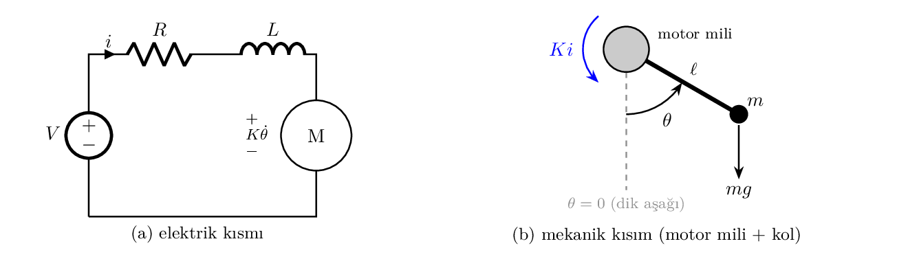

Açı $\theta$ **dik aşağıdan** ölçülüyor: $\theta = 0$ kol aşağı sarkık, $\theta = 90^\circ$ kol yatay, $\theta = 180^\circ$ kol dik yukarı.

### B.6 Durumlar, giriş ve çıkış

| Sembol | Anlamı | Birim | Tür |
|---|---|---|---|
| $x_1 = \theta$ | kolun açısı | rad | **durum** |
| $x_2 = \omega = \dot\theta$ | kolun dönme hızı | rad/s | **durum** |
| $x_3 = i$ | motor sargısındaki akım | A | **durum** |
| $u = V$ | motora uygulanan gerilim | V | **giriş** |
| $y = \theta$ | ölçülen açı (enkoder) | rad | **çıkış** |

- **Neden 3 durum?** Kolun nereye gideceğini tahmin etmek için açıyı ve hızı bilmek gerekiyor (mekanik kısım). Akım ise motor sargısının "hafızası": bobinden geçen akım bir anda değişemiyor, bu yüzden o da ayrı bir durum.
- **Sistem tipi:** 3 durum, 1 giriş, 1 çıkış → **SISO**, **doğrusal olmayan** ($\sin\theta$ terimi yüzünden), **zamanla değişmeyen**.

### B.7 Hareket denklemleri

**Mekanik kısım:** motor torku kolu döndürüyor, sürtünme ve yerçekimi karşı koyuyor:

$$J\ddot\theta = K i - b\dot\theta - mg\ell\sin\theta, \qquad J = J_m + m\ell^2$$

**Elektrik kısmı:** sargı bir seri RL devresi; uygulanan gerilim direnç, bobin ve zıt EMK arasında paylaşılıyor (Kirchhoff gerilim yasası):

$$L\frac{di}{dt} = V - R i - K\dot\theta$$

| Denklem parçası | Kaynak |
|---|---|
| Motorun mekanik denklemi ($J_m\ddot\theta + b\dot\theta = K i$) | CTMS, "DC Motor Speed: System Modeling" [1] |
| Motorun elektrik denklemi ($L\,di/dt + R i = V - K\dot\theta$) | CTMS, aynı sayfa [1] |
| Yerçekimi terimi ($-mg\ell\sin\theta$) | Hespanha, Example 2.1 (ters sarkaç) [2]; kitapta açı yukarıdan ölçüldüğü için $+$, bizde aşağıdan ölçüldüğü için $-$ |
| Toplam eylemsizlik $J = J_m + m\ell^2$ | kolu ekleyerek kurduğumuz |

Hespanha'daki mekanik sistem kalıbıyla (2.7) karşılaştırma, $M(q)\ddot q + B(q,\dot q)\dot q + G(q) = F$:

| Kalıp | Bizde | Anlamı |
|---|---|---|
| $q$ | $\theta$ | kolun açısı |
| $M(q)$ | $J = 0.0105$ | eylemsizlik (sabit) |
| $B(q,\dot q)$ | $b = 0.1$ | sürtünme (sabit) |
| $G(q)$ | $mg\ell\sin\theta$ | yerçekimi torku |
| $F$ | $K i$ | motor torku |

### B.8 Durum uzayı modeli ve parametreler

Mekanik denklemi $J$'ye, elektrik denklemini $L$'ye bölünce:

$$\dot x_1 = x_2, \qquad \dot x_2 = \frac{K x_3 - b x_2 - mg\ell\sin x_1}{J}, \qquad \dot x_3 = \frac{u - R x_3 - K x_2}{L}, \qquad y = x_1$$

| Parametre | Anlamı | Değer | Kaynak |
|---|---|---|---|
| $J_m$ | motor rotorunun eylemsizliği | 0.01 kg·m² | CTMS [1], [3] ile kontrol edildi |
| $b$ | sürtünme katsayısı | 0.1 N·m·s | CTMS [1] |
| $K$ | motor sabiti ($K_t = K_e$) | 0.01 N·m/A | CTMS [1] |
| $R$ | sargı direnci | 1 Ω | CTMS [1] |
| $L$ | sargı endüktansı | 0.5 H | CTMS [1] |
| $m$ | kolun ucundaki kütle | 0.05 kg | tasarım hesabı |
| $\ell$ | kol uzunluğu | 0.1 m | tasarım hesabı |
| $g$ | yerçekimi ivmesi | 9.81 m/s² | |
| $J$ | toplam eylemsizlik $J_m + m\ell^2$ | 0.0105 kg·m² | hesap |

**Sayısal model:**

$$\dot x_1 = x_2, \qquad \dot x_2 = 0.952\,x_3 - 9.52\,x_2 - 4.67\sin x_1, \qquad \dot x_3 = 2\,u - 2\,x_3 - 0.02\,x_2, \qquad y = x_1$$

**Kol ölçülerinin tasarım hesabı.** Motor sabiti küçük ($K = 0.01$ N·m/A): 1 A akımla yalnızca 0.01 N·m tork üretiyor. Bu yüzden hafif bir kol seçildi ve motorun en zor durumda, yani kol yataydayken ($\sin 90^\circ = 1$) tutabildiği kontrol edildi:

- Yerçekiminin torku: $mg\ell = 0.05 \times 9.81 \times 0.1 \approx 0.049$ N·m
- Gereken akım: $0.049 / 0.01 \approx 4.9$ A
- Gereken gerilim (kol dururken): $R i = 1 \times 4.9 \approx 4.9$ V

12 V'luk bir besleme bunu rahatça karşılıyor; motor kolu her açıda tutabiliyor.

### B.9 Blok diyagram

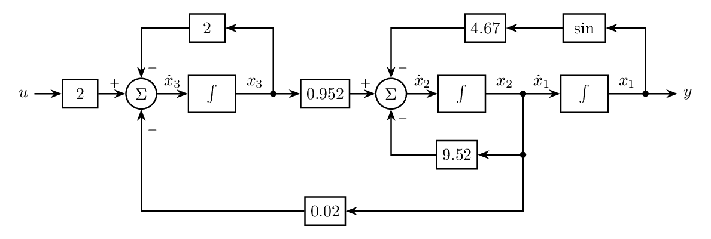

- **İleri yol** (soldan sağa): gerilim → akım → hız → açı. Her durum bir integratörün (∫) çıkışı.
- **Üstteki geri dönüşler:** sargı direnci ($R/L = 2$) ve yerçekimi ($\sin$ → 4.67).
- **Alttaki geri dönüşler:** sürtünme (9.52) ve zıt EMK (0.02). Zıt EMK hızdan akıma geri dönüyor: motor hızlandıkça akım azalıyor.

### B.10 Denge noktaları ve 90° doğrusallaştırma

Dengede bütün değişim hızları sıfır:

$$x^{eq} = (\theta_0,\ 0,\ 4.9\sin\theta_0), \qquad u^{eq} = 4.9\sin\theta_0 \text{ V}$$

| Açı $\theta_0$ | Akım $x_3$ | Gerilim $u^{eq}$ | Anlamı |
|---|---|---|---|
| 0° (aşağı sarkık) | 0 A | 0 V | motorun bir şey yapmasına gerek yok |
| 45° | 3.5 A | 3.5 V | |
| **90° (yatay)** | **4.9 A** | **4.9 V** | en zor durum, motor kolun bütün ağırlığını taşıyor |

90° etrafında Jacobian'daki tek değişken terim $-4.67\cos x_1$, ve $\cos 90^\circ = 0$ olduğu için sıfır:

$$A = \begin{bmatrix} 0 & 1 & 0\\ 0 & -9.52 & 0.952\\ 0 & -0.02 & -2\end{bmatrix}, \qquad B = \begin{bmatrix} 0\\ 0\\ 2\end{bmatrix}, \qquad C = \begin{bmatrix} 1 & 0 & 0\end{bmatrix}, \qquad D = 0$$

$A$'nın ilk sütunu sıfır: bu noktada yerçekiminin kolu geri iten etkisi kayboluyor. Özdeğerler (`eig(A)`): $0$, $-9.5213$, $-2.0025$.

### B.11 Açık çevrim simülasyonu

Motora sabit denge gerilimi ($u = R\,mg\ell/K = 4.905$ V) verilip kol 80°, 90° ve 100°'den bırakıldı; `ode45` ile 60 s.

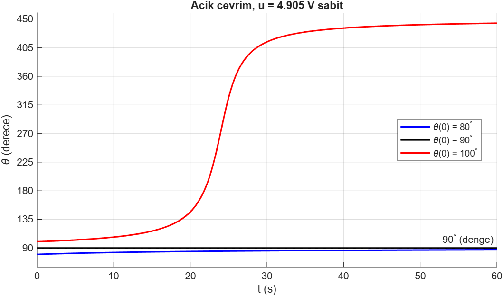

| $\theta(0)$ | $\theta(60\text{ s})$ | Ne oldu? |
|---|---|---|
| 80° | 87.2° | 90°'ye doğru çok yavaş yaklaşıyor |
| 90° | 90.0° | hiç kıpırdamıyor |
| 100° | 443.6° | uzaklaşıyor, tam bir tur dönüp tekrar 90°'ye (450°) geliyor |

Motorun torku sabit ($0.049$ N·m); yerçekimi bu değere tam 90°'de ulaşıyor. 80° ve 100°'de motor kazanıyor ve kolu yukarı itiyor: 80°'de yukarısı dengeye doğru, 100°'de dengeden uzağa doğru. Sıfır özdeğer de bunu söylüyor: 90° masanın kenarında duran bir bilye gibi.

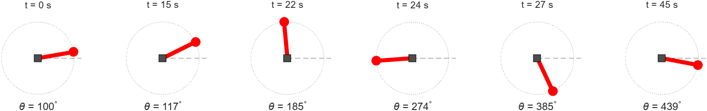

*$\theta(0) = 100^\circ$: kol tepeden geçip ($t = 22$ s) tam tur atıyor ve 90°'ye geri geliyor.*

**Sonuç:** Sabit gerilim kolu 90°'de güvenle tutmaya yetmiyor; geri besleme gerekiyor. Gerçek düzenekte motor dişli kutulu olacağı için model, araştırma bölümündeki iki kütleli modele genişletildi.

### Temel modeli çalıştırma

```matlab
cd matlab
acik_cevrim      % ode45 açık çevrim simülasyonu + özdeğerler
animasyon        % 2D kol animasyonu -> sekiller/model_animasyon.gif
```

## Kaynaklar

1. B. Messner, D. Tilbury, R. Hill, *Control Tutorials for MATLAB and Simulink*, "DC Motor Speed: System Modeling", University of Michigan. <https://ctms.engin.umich.edu/CTMS/index.php?example=MotorSpeed&section=SystemModeling>
2. J. P. Hespanha, *Linear Systems Theory*, Princeton University Press, 2009.
3. Aynı CTMS sayfasının University of Maryland ENME462 kopyası. <https://terpconnect.umd.edu/~sandborn/courses/ENME462/Studio5/5-motor.htm>
4. L. Sun, X. Li, L. Chen, H. Shi, Z. Jiang, "Dual-motor coordination for high-quality servo with transmission backlash," *IEEE Trans. Ind. Electron.*, 70(2), 2023.
5. A. Esbrook, X. Tan, H. K. Khalil, "Self-excited limit cycles in an integral-controlled system with backlash," *IEEE Trans. Autom. Control*, 59(4), 2014.
6. A. Ghaffari, E. Mohammadiasl, "Calculating the frequency of oscillation for servo axes distressed by clearance or preloading," *IEEE/ASME Trans. Mechatronics*, 18(3), 2013.
7. J. Padron ve ark., "Evaluating the equivalence between nonlinear friction and backlash in two-inertia systems," *IEEE AMC*, 2022.

Tam kaynak listesi ve okuma notları: [`literatur/okuma_notlari.md`](literatur/okuma_notlari.md).

---

**Şafak Şahin** · 2026
