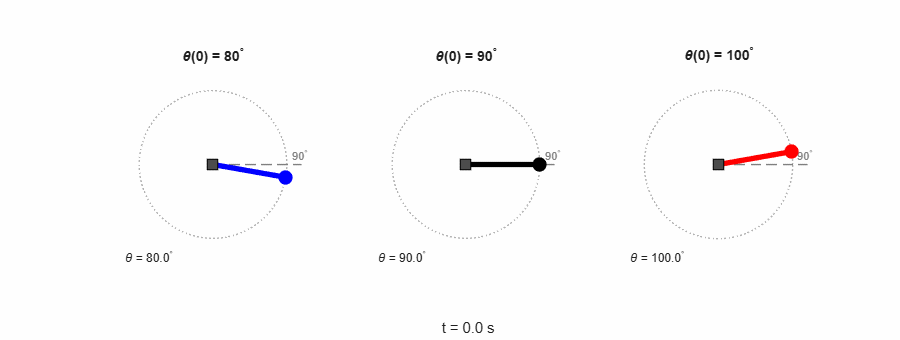

# DC Motorlu Tek Eklemli Robot Kolu

Bir DC motor, ucunda küçük bir ağırlık olan bir kolu döndürüyor. Amacımız motora uygulanan gerilimle kolu istenen açıda tutmak. Bu repo sistemin **durum uzayı modelini**, **denge noktalarını** ve MATLAB ile **açık çevrim simülasyonunu** içeriyor.

İstinye Üniversitesi **EEM5507 Doğrusal Sistemler Teorisi** dersinin proje başlangıcı (KT1) olarak hazırlandı. Ders kitabı: J. P. Hespanha, *Linear Systems Theory*.



*Motora sabit 4.905 V verildiğinde kolun üç farklı başlangıç açısından (80°, 90°, 100°) davranışı.*

---

## İçindekiler

1. [Neden bu proje?](#1-neden-bu-proje)
2. [Fiziksel sistem](#2-fiziksel-sistem)
3. [Durumlar, giriş ve çıkış](#3-durumlar-giriş-ve-çıkış)
4. [Hareket denklemleri](#4-hareket-denklemleri)
5. [Durum uzayı modeli](#5-durum-uzayı-modeli)
6. [Parametreler](#6-parametreler)
7. [Blok diyagram](#7-blok-diyagram)
8. [Denge noktaları](#8-denge-noktaları)
9. [Açık çevrim simülasyonu](#9-açık-çevrim-simülasyonu)
10. [Dosya yapısı ve çalıştırma](#10-dosya-yapısı-ve-çalıştırma)
11. [Sonraki adımlar](#11-sonraki-adımlar)
12. [Kaynaklar](#12-kaynaklar)

---

## 1. Neden bu proje?

1. Proje elektrik-elektronik mühendisliğine daha yakın olduğu için kendime daha yakın buldum.
2. Simülasyon uygulamalarında projeyi 2D/3D olarak modelleyebilirim. Kişisel olarak bu şekilde modellenebilen projeler her zaman daha çok ilgimi çekmiştir.
3. Projeyi basit geliştirme kartları ile kendim fiziksel olarak gerçekleştirebilirim.

## 2. Fiziksel sistem

Sistem iki kısımdan oluşuyor: motorun **elektrik devresi** ve motor miline bağlı **kol**. İki kısım motor üzerinden birbirine bağlı: akım $i$ milde $K i$ torkunu üretiyor, mil döndükçe de devrede $K\dot\theta$ zıt EMK'sı oluşuyor.


Açı $\theta$ **dik aşağıdan** ölçülüyor: $\theta = 0$ kol aşağı sarkık, $\theta = 90^\circ$ kol yatay, $\theta = 180^\circ$ kol dik yukarı.

## 3. Durumlar, giriş ve çıkış

| Sembol | Anlamı | Birim | Tür |
|---|---|---|---|
| $x_1 = \theta$ | kolun açısı | rad | **durum** |
| $x_2 = \omega = \dot\theta$ | kolun dönme hızı | rad/s | **durum** |
| $x_3 = i$ | motor sargısındaki akım | A | **durum** |
| $u = V$ | motora uygulanan gerilim | V | **giriş** |
| $y = \theta$ | ölçülen açı (enkoder) | rad | **çıkış** |

- **Neden 3 durum?** Kolun nereye gideceğini tahmin etmek için açıyı ve hızı bilmek gerekiyor (mekanik kısım). Akım ise motor sargısının "hafızası": bobinden geçen akım bir anda değişemiyor, bu yüzden o da ayrı bir durum.
- **Sistem tipi:** 3 durum, 1 giriş, 1 çıkış → **SISO**, **doğrusal olmayan** ($\sin\theta$ terimi yüzünden), **zamanla değişmeyen**.

## 4. Hareket denklemleri

**Mekanik kısım:** motor torku kolu döndürüyor, sürtünme ve yerçekimi karşı koyuyor:

$$J\ddot\theta = K i - b\dot\theta - mg\ell\sin\theta, \qquad J = J_m + m\ell^2$$

**Elektrik kısmı:** sargı bir seri RL devresi; uygulanan gerilim direnç, bobin ve zıt EMK arasında paylaşılıyor (Kirchhoff gerilim yasası):

$$L\frac{di}{dt} = V - R i - K\dot\theta$$

| Denklem parçası | Kaynak |
|---|---|
| Motorun mekanik denklemi ($J_m\ddot\theta + b\dot\theta = K i$) | CTMS, "DC Motor Speed: System Modeling" [1] |
| Motorun elektrik denklemi ($L\,di/dt + R i = V - K\dot\theta$) | CTMS, aynı sayfa [1] |
| Yerçekimi terimi ($-mg\ell\sin\theta$) | Hespanha, Example 2.1 (ters sarkaç) [2]; kitapta açı yukarıdan ölçüldüğü için $+$, bizde aşağıdan ölçüldüğü için $-$ |
| Toplam eylemsizlik $J = J_m + m\ell^2$ | kolu ekleyerek bizim kurduğumuz |

**Kitaptaki mekanik sistem kalıbı (2.7)** ile karşılaştırma, $M(q)\ddot q + B(q,\dot q)\dot q + G(q) = F$:

| Kalıp | Bizde | Anlamı |
|---|---|---|
| $q$ | $\theta$ | kolun açısı |
| $M(q)$ | $J = 0.0105$ | eylemsizlik (sabit) |
| $B(q,\dot q)$ | $b = 0.1$ | sürtünme (sabit) |
| $G(q)$ | $mg\ell\sin\theta$ | yerçekimi torku |
| $F$ | $K i$ | motor torku |

## 5. Durum uzayı modeli

Mekanik denklemi $J$'ye, elektrik denklemini $L$'ye bölünce:

$$\dot x_1 = x_2, \qquad \dot x_2 = \frac{K x_3 - b x_2 - mg\ell\sin x_1}{J}, \qquad \dot x_3 = \frac{u - R x_3 - K x_2}{L}, \qquad y = x_1$$

Sayılar yerine konunca katsayılar:

| Katsayı | Hesap | Değer |
|---|---|---|
| $K/J$ | 0.01 / 0.0105 | 0.952 |
| $b/J$ | 0.1 / 0.0105 | 9.52 |
| $mg\ell/J$ | 0.0491 / 0.0105 | 4.67 |
| $1/L$ | 1 / 0.5 | 2 |
| $R/L$ | 1 / 0.5 | 2 |
| $K/L$ | 0.01 / 0.5 | 0.02 |

**Sayısal model:**

$$\dot x_1 = x_2$$

$$\dot x_2 = 0.952\,x_3 - 9.52\,x_2 - 4.67\sin x_1$$

$$\dot x_3 = 2\,u - 2\,x_3 - 0.02\,x_2$$

$$y = x_1$$

Doğrusal olmayan tek terim $\sin x_1$.

## 6. Parametreler

| Parametre | Anlamı | Değer | Kaynak |
|---|---|---|---|
| $J_m$ | motor rotorunun eylemsizliği | 0.01 kg·m² | CTMS [1], [3] ile kontrol edildi |
| $b$ | sürtünme katsayısı | 0.1 N·m·s | CTMS [1] |
| $K$ | motor sabiti ($K_t = K_e$) | 0.01 N·m/A | CTMS [1] |
| $R$ | sargı direnci | 1 Ω | CTMS [1] |
| $L$ | sargı endüktansı | 0.5 H | CTMS [1] |
| $m$ | kolun ucundaki kütle | 0.05 kg | tasarım hesabı |
| $\ell$ | kol uzunluğu | 0.1 m | tasarım hesabı |
| $g$ | yerçekimi ivmesi | 9.81 m/s² | |
| $J$ | toplam eylemsizlik $J_m + m\ell^2$ | 0.0105 kg·m² | hesap |

**Kol ölçülerinin tasarım hesabı.** Motor sabiti küçük ($K = 0.01$ N·m/A): 1 A akımla yalnızca 0.01 N·m tork üretiyor. Bu yüzden hafif bir kol seçtik ve motorun en zor durumda, yani kol yataydayken ($\sin 90^\circ = 1$) tutabildiğini kontrol ettik:

- Yerçekiminin torku: $mg\ell = 0.05 \times 9.81 \times 0.1 \approx 0.049$ N·m
- Gereken akım: $0.049 / 0.01 \approx 4.9$ A
- Gereken gerilim (kol dururken): $R i = 1 \times 4.9 \approx 4.9$ V

12 V'luk bir besleme bunu rahatça karşılıyor, yani motor kolu her açıda tutabiliyor.

## 7. Blok diyagram


- **İleri yol** (soldan sağa): gerilim → akım → hız → açı. Her durum bir integratörün (∫) çıkışı.
- **Üstteki geri dönüşler:** sargı direnci ($R/L = 2$) ve yerçekimi ($\sin$ → 4.67).
- **Alttaki geri dönüşler:** sürtünme (9.52) ve zıt EMK (0.02). Zıt EMK hızdan akıma geri dönüyor: motor hızlandıkça akım azalıyor. Elektrik ve mekanik kısım bu okla birbirine bağlanıyor.
- **Kontrol:** 3 integratör (3 durum), 6 kazanç (6 katsayı), 2 toplama bloğu, 1 doğrusal olmayan $\sin$ bloğu.

## 8. Denge noktaları

Kolu $\theta_0$ açısında tutmak istiyoruz. Dengede bütün değişim hızları sıfır olmalı:

1. $\dot x_1 = 0 \Rightarrow x_2 = 0$: kol dönmüyor.
2. $\dot x_2 = 0$, $x_2 = 0$ yazınca $0.952\,x_3 = 4.67\sin\theta_0$, yani $x_3 \approx 4.9\sin\theta_0$: motorun yerçekimini dengelemesi için gereken akım.
3. $\dot x_3 = 0$, $x_2 = 0$ yazınca $2u = 2x_3$, iki taraf 2'ye bölünce $u = x_3$.

$$x^{eq} = (\theta_0,\ 0,\ 4.9\sin\theta_0), \qquad u^{eq} = 4.9\sin\theta_0 \text{ V}$$

| Açı $\theta_0$ | Akım $x_3$ | Gerilim $u^{eq}$ | Anlamı |
|---|---|---|---|
| 0° (aşağı sarkık) | 0 A | 0 V | motorun bir şey yapmasına gerek yok |
| 45° | 3.5 A | 3.5 V | |
| **90° (yatay)** | **4.9 A** | **4.9 V** | en zor durum, motor kolun bütün ağırlığını taşıyor |

Projede kullanacağımız çalışma noktası: **$\theta_0 = 90^\circ$ (kol yatay)**. Hem en zor durum hem de kontrol açısından en ilginç olanı.

### 90° etrafında doğrusallaştırma

Genel Jacobian tablosu (her satır bir $f$'nin türevleri):

| | $\partial/\partial x_1$ | $\partial/\partial x_2$ | $\partial/\partial x_3$ | $\partial/\partial u$ |
|---|---|---|---|---|
| $f_1 = x_2$ | 0 | 1 | 0 | 0 |
| $f_2 = 0.952x_3 - 9.52x_2 - 4.67\sin x_1$ | $-4.67\cos x_1$ | −9.52 | 0.952 | 0 |
| $f_3 = 2u - 2x_3 - 0.02x_2$ | 0 | −0.02 | −2 | 2 |
| $y = x_1$ | 1 | 0 | 0 | 0 |

Tek değişken kutu $-4.67\cos x_1$; $x_1 = 90^\circ$'de $\cos 90^\circ = 0$ olduğu için o da sıfır oluyor:

$$A = \begin{bmatrix} 0 & 1 & 0\\ 0 & -9.52 & 0.952\\ 0 & -0.02 & -2\end{bmatrix}, \qquad B = \begin{bmatrix} 0\\ 0\\ 2\end{bmatrix}, \qquad C = \begin{bmatrix} 1 & 0 & 0\end{bmatrix}, \qquad D = 0$$

$A$'nın ilk sütunu tamamen sıfır: bu noktada açı hiçbir durumun değişim hızını etkilemiyor, yani yerçekiminin kolu geri iten etkisi kayboluyor. Bu yüzden özdeğerlerden biri $0$; diğer ikisi hız–akım kısmının köşegenine çok yakın (`eig(A)`): $0$, $-9.5213$, $-2.0025$.

## 9. Açık çevrim simülasyonu

Motora sabit denge gerilimini veriyoruz ($u = R\,mg\ell/K = 4.905$ V, yuvarlamadan) ve kolu 90°'nin biraz altından, tam üstünden ve biraz üstünden bırakıyoruz. Denklemler MATLAB'da `ode45` ile 60 s boyunca çözülüyor.

| Giriş | Başlangıç | Süre | Çıkış |
|---|---|---|---|
| $u = 4.905$ V (sabit) | $\theta(0) = 80^\circ, 90^\circ, 100^\circ$; $\omega(0) = 0$; $i(0) = 4.905$ A | 60 s | $y = \theta(t)$ |


| $\theta(0)$ | $\theta(60\text{ s})$ | Ne oldu? |
|---|---|---|
| 80° | 87.2° | 90°'ye doğru çok yavaş yaklaşıyor |
| 90° | 90.0° | hiç kıpırdamıyor |
| 100° | 443.6° | uzaklaşıyor, tam bir tur dönüp tekrar 90°'ye (450°) geliyor |

**Neden?** Motorun torku sabit: $K i = 0.01 \times 4.905 = 0.049$ N·m. Yerçekiminin torku $mg\ell\sin\theta$ ve en büyük değeri olan 0.049'a tam 90°'de ulaşıyor. Yani 90°'de iki tork eşit, kol duruyor. 80°'de ve 100°'de $\sin\theta < 1$ olduğu için yerçekimi daha zayıf ve motor kazanıyor; motor kolu her iki durumda da yukarı itiyor. 80°'de yukarısı 90°'ye doğru, kol dengeye yaklaşıyor. 100°'de ise yukarısı 90°'den uzağa doğru: kol tepeden geçiyor, düşerken yerçekimi de yardım ediyor ve tam bir tur atıyor.

**Özdeğerler.** 90°'de doğrusallaştırılmış sistemin özdeğerleri:

$$\lambda_1 = 0, \qquad \lambda_2 = -9.52, \qquad \lambda_3 = -2.00$$

$-9.52$ ve $-2.00$ sürtünmeden ve motorun elektrik kısmından gelen hızlı sönümler. $0$ ise $\cos 90^\circ = 0$ olmasından geliyor: bu noktada yerçekiminin eğimi sıfır, kolu geri itecek bir etki yok. Masanın kenarında duran bir bilye gibi; bir yana itersek geri geliyor, öbür yana itersek düşüyor.


*$\theta(0) = 100^\circ$: kol tepeden geçip ($t = 22$ s) tam tur atıyor ve 90°'ye geri geliyor.*

**Sonuç:** Sabit gerilim verip bırakmak kolu 90°'de güvenle tutmaya yetmiyor; küçük bir sapma kolu tam tura gönderebiliyor. Bu yüzden geri besleme (kontrolcü) gerekiyor.

## 10. Dosya yapısı ve çalıştırma

```
dc-motor-robot-arm/
├── README.md
├── matlab/
│   ├── kt1.m               # ode45 açık çevrim simülasyonu + özdeğerler → kt1_acik_cevrim.png
│   ├── kt1_animasyon.m     # 2D kol animasyonu (ekranda oynar) → kt1_animasyon.gif
│   └── kt1_filmseridi.m    # θ(0)=100° durumundan seçilen kareler → kt1_filmseridi.png
├── sekiller/               # MATLAB ve LaTeX çıktıları (README'deki tüm görseller)
└── latex/
    ├── kt1.tex / kt1.pdf   # projenin tam raporu (denklem çözümleri, tüm tablolar)
    ├── sema.tex            # fiziksel şema (standalone)
    └── blok_diyagram.tex   # blok diyagram (standalone)
```

**MATLAB** (ek araç kutusu gerekmiyor; R2026b ile test edildi):

```matlab
cd matlab
kt1              % grafik + özdeğerler
kt1_animasyon    % animasyon (GIF'i de yeniden kaydeder)
kt1_filmseridi   % film şeridi
```

**LaTeX** (`pdflatex`, paketler: babel-turkish, tikz, circuitikz, booktabs, float):

```
cd latex
pdflatex kt1.tex
```

## 11. Sonraki adımlar

- 90° etrafındaki doğrusal modelin kararlılık, kontrol edilebilirlik ve gözlemlenebilirlik analizi
- Geri besleme kontrolcüsü tasarımı (kolu 90°'de kararlı tutmak)
- Kapalı çevrim simülasyonu ve animasyonu
- Geliştirme kartı (Arduino vb.) + DC motor + enkoder ile fiziksel uygulama

## 12. Kaynaklar

1. B. Messner, D. Tilbury, R. Hill, *Control Tutorials for MATLAB and Simulink*, "DC Motor Speed: System Modeling", University of Michigan. <https://ctms.engin.umich.edu/CTMS/index.php?example=MotorSpeed&section=SystemModeling> (erişim: 13 Ekim 2026)
2. J. P. Hespanha, *Linear Systems Theory*, Princeton University Press, 2009: §2.4.1 denklem (2.7), Example 2.1, Definition 2.1 ve 2.2.
3. Aynı CTMS sayfasının University of Maryland ENME462 dersindeki kopyası (motor parametrelerini buradan da kontrol ettik). <https://terpconnect.umd.edu/~sandborn/courses/ENME462/Studio5/5-motor.htm> (erişim: 13 Ekim 2026)

Denklemlerin hangisinin hangi kaynaktan, hangisinin ödevin önceki sorularından geldiğini gösteren tam tablo `latex/kt1.pdf`'in sonunda.

---

**Şafak Şahin** · EEM5507 Doğrusal Sistemler Teorisi · 2026–27 Güz
