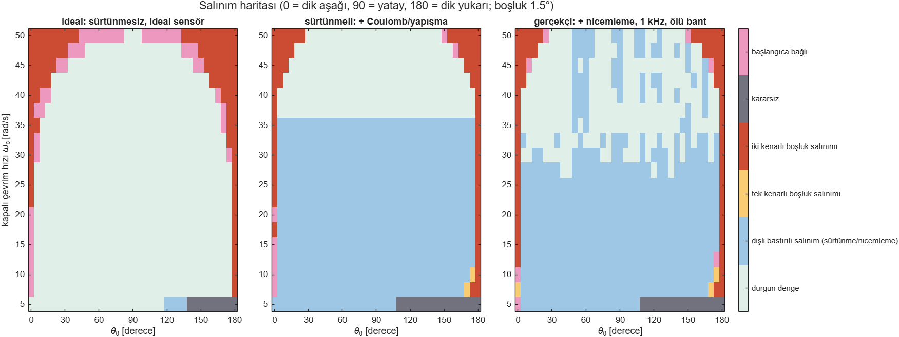
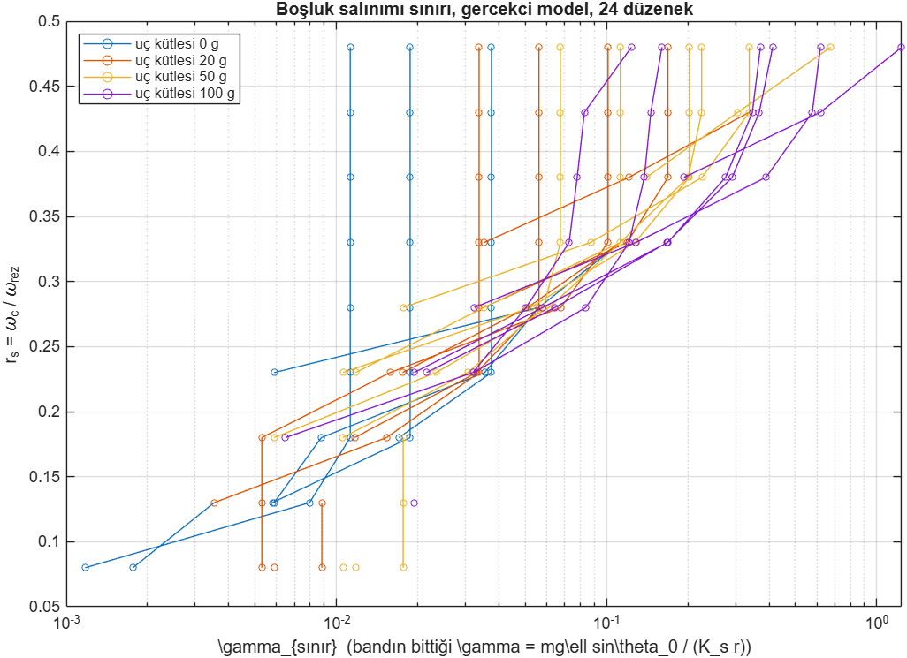
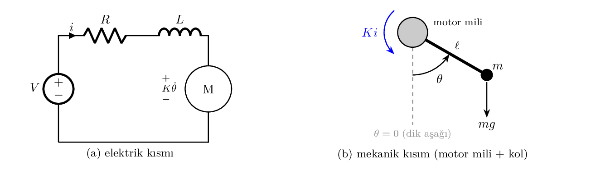
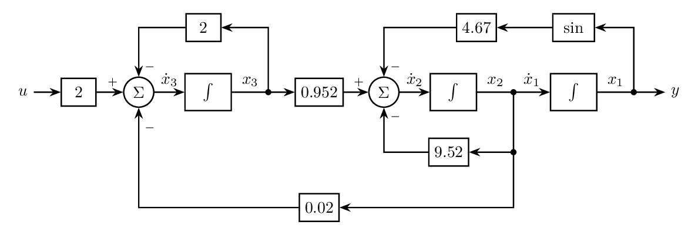
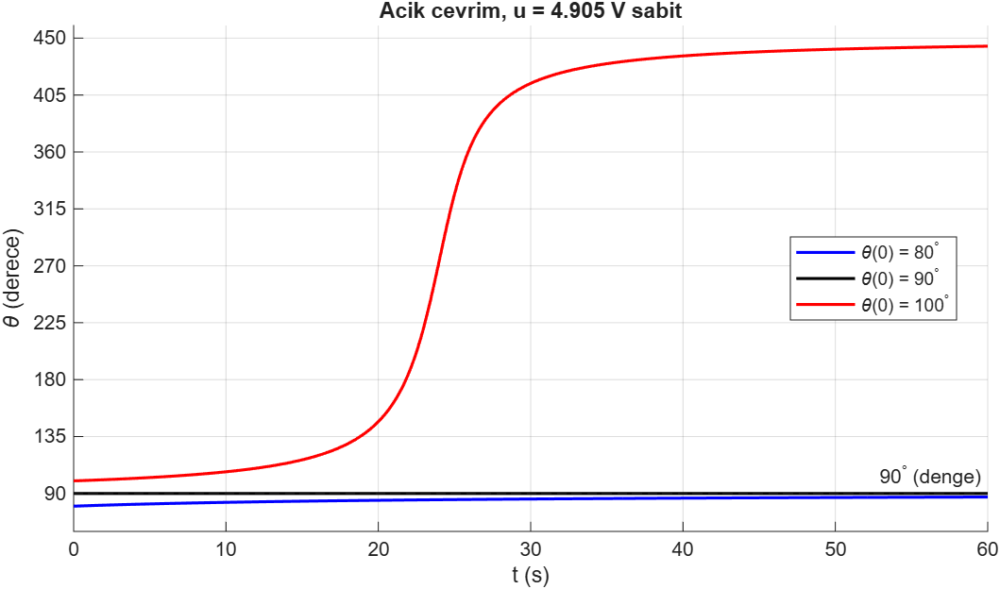
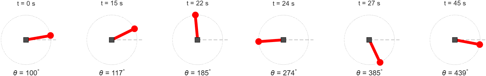

# Dişli DC Motorlu Tek Eklemli Robot Kol

Tek eklemli, dişli DC motorla sürülen bir robot kolunun modellenmesi, simülasyonu ve fiziksel gerçeklenmesi. Proje, kolun doğrusal olmayan durum uzayı modeliyle başladı ve **dişli boşluğunun (backlash) ürettiği sürekli salınımların kolun çalışma açısına nasıl bağlı olduğunu** inceleyen bir araştırmaya dönüştü.

**Araştırma defteri (adım adım günlük, literatür, simülasyon, malzeme):** <https://safaksahinn.github.io/dc-motor-robot-arm/>

**Çalışma notu (hazırlanıyor):** [framing ve kısıtlar](calisma_notu/framing.md) · [donanım ve yazılım planı](calisma_notu/mimari.md) · [framing adaylarının karşılaştırması](calisma_notu/framing_adaylari.md)


*Temel model: motora sabit 4.905 V verildiğinde kolun üç farklı başlangıç açısından (80°, 90°, 100°) davranışı.*

---

## İçindekiler

**Bölüm I: Araştırma**
1. [Araştırma sorusu](#1-araştırma-sorusu)
2. [Literatür](#2-literatür)
3. [Simülasyon bulguları](#3-simülasyon-bulguları)
4. [Donanım](#4-donanım)

**Bölüm II: Temel model**

5. [Fiziksel sistem](#5-fiziksel-sistem)
6. [Durumlar, giriş ve çıkış](#6-durumlar-giriş-ve-çıkış)
7. [Hareket denklemleri](#7-hareket-denklemleri)
8. [Durum uzayı modeli ve parametreler](#8-durum-uzayı-modeli-ve-parametreler)
9. [Blok diyagram](#9-blok-diyagram)
10. [Denge noktaları ve 90° doğrusallaştırma](#10-denge-noktaları-ve-90-doğrusallaştırma)
11. [Açık çevrim simülasyonu](#11-açık-çevrim-simülasyonu)

**Bölüm III**

12. [Dosya yapısı ve çalıştırma](#12-dosya-yapısı-ve-çalıştırma)
13. [Kaynaklar](#13-kaynaklar)

---

# Bölüm I: Araştırma

## 1. Araştırma sorusu

Ucuz dişli motorlarda dişliler arasında bir boşluk vardır. Konum kontrolünde bu boşluk, kolun hedef etrafında durmadan salınmasına (limit cycle) yol açabilir. Literatürde bu konu geniş biçimde çalışılmış, ama neredeyse her zaman **yatay** düzeneklerde: iki kütleli tahrikler, takım tezgâhları, döner tablalar.

Düşey düzlemde çalışan bir kolda durum farklıdır. Yerçekimi torku $mg\ell\sin\theta_0$ dişliyi sürekli bir kenara bastırır:

- **90° (yatay):** yerçekimi torku en büyük, dişli bastırılı.
- **0° (aşağı) ve 180° (yukarı):** yerçekimi torku sıfır, boşluk tamamen etkin.

**Hipotez.** Boşluk, dişlinin ilettiği tork sıfırdan geçtiğinde devreye girer. Kolda bu tork, sabit yerçekimi torku ile salınımlı dinamik torkun toplamıdır. Yerçekimi bu sıfır geçişlerini açıya göre engeller ya da serbest bırakır. Dolayısıyla boşluk kaynaklı salınımın var olup olmadığı **çalışma açısı ile kontrolcü kazancının birlikte** belirlediği bir haritaya göre değişir.

**Hedeflenen katkılar:**
- Yerçekimsiz sistemlerde "sabit referans limit cycle'ı yalnızca kaydırır" sonucunun (Esbrook, Tan, Khalil 2014) yerçekimli kolda geçerli olmadığını göstermek.
- Açı–kazanç düzleminde nicel bir harita ve kaymalı (bias) tanımlama fonksiyonuyla analitik açıklama.
- Açıya göre ayarlanan bir bozucu gözlemci.
- Erişilebilir bir düzenekte (dişli DC motor, ESP32, manyetik açı sensörü, 20 bit akım ölçümü) deneysel doğrulama; ortam ve motor sıcaklığı her deneyle birlikte kaydedilir.

## 2. Literatür

- IEEE Xplore'da 26 sorgu (130 sonuç), IEEE dışında OpenAlex ile başlık+özet araması, Web of Science Core Collection'da 12 sorgu (44 kayıt) ve en yakın makalelere atıf yapan çalışmaların taranması.
- 37 makalenin tam metni okundu. Notlar: [`literatur/okuma_notlari.md`](literatur/okuma_notlari.md); tarama özetleri: [`literatur/ieee_disi/tarama_ozeti_2026-10-18.md`](literatur/ieee_disi/tarama_ozeti_2026-10-18.md), [`literatur/wos/wos_tarama_2026-10-22.md`](literatur/wos/wos_tarama_2026-10-22.md).
- Belirleyici sorgu "boşluk + yerçekimi + tanımlama fonksiyonu": OpenAlex'te ve Web of Science'ta **0 sonuç**.
- En yakın çalışma Sun ve ark. (2023, IEEE TIE). Düşey düzlemde salınan bir kolu modelliyorlar ($M_L\sin\theta_L$ terimiyle) ve 90°'de yüksek kazançta salınım gözlüyorlar. Ama yerçekiminin etkisini incelemiyorlar ve tek bir açıda çalışıyorlar.
- "Yerçekimi dişliye ön yük gibi davranır" fikri, endüstriyel robotlarda statik boşluk telafisi için biliniyor (Ahmad 1985; Karim ve ark. 2018). 7 eksenli D-Arm kolunda, bağ dik konumdan geçerken yerçekimi torkunun yön değiştirip dişliyi karşı yüze çarptırdığı gözlenmiş (Xu ve ark. 2023, IEEE RA-L), ama analiz edilmemiş. Kapalı çevrim kararlılığına bağlanmamış.

## 3. Simülasyon bulguları

İki kütleli model kuruldu: motor ve kol, arada dişli sertliği ve boşluk; kolda yerçekimi; PID kontrol. Üç model seviyesinde çalışıldı: ideal; Coulomb ve yapışma sürtünmeli; gerçekçi (12 bit açı sensörü, enkoder nicemlemesi, 1 kHz kontrol, sürücü ölü bandı). Kod: [`simulasyon/`](simulasyon/), ayrıntılı sonuçlar: [`simulasyon/sonuclar_2026-10-18.md`](simulasyon/sonuclar_2026-10-18.md).



*Açı × kapalı çevrim hızı haritası. Kırmızı: dişlinin iki kenarı arasında gidip geldiği boşluk salınımı. Mavi: dişli bastırılıyken oluşan sürtünme/nicemleme salınımı.*

1. **Sönüm motor tarafından alınmalı.** Türev terimi kol hızından alınınca, boşluk olmasa bile döngü dişli rezonansında kararsızlaşıyor. Motor enkoderinden alınınca kararlı kalıyor.
2. **Hipotez benzetimde görülüyor.** Boşluk salınımı 0° ve 180° civarında toplanıyor; 90° etrafında salınımsız bir bölge var ve bu bölge kazanç arttıkça daralıyor.
3. **Sürtünme açıdan bağımsız ikinci bir salınım yaratıyor**, ama bu sırada dişli bastırılı kalıyor. Boşluğu sürtünmeden ayıran ölçüm, motor açısı ile kol açısı arasındaki farktır ($\theta_d$). Bu yüzden iki açı sensörü gerekiyor.
4. **En güçlü deney değişkeni boşluk genişliği.** Boşluk 1,5°'den 3°'ye ve 5°'ye çıkınca salınım bandı belirgin biçimde genişliyor.
5. **Sonuçlar boyutsuz bir haritada toplanıyor.** İki boyutsuz sayı kullanılıyor: $\gamma = mg\ell\sin\theta_0/(K_s r)$ (yerçekimi torkunun, boşluğu kapatan dişli torkuna oranı) ve $r_s = \omega_c/\omega_{rez}$ (kontrolcü hızının dişli rezonans frekansına oranı). 24 farklı düzenek aynı şeride düşüyor; ideal modelde yaklaşık $\gamma_{sınır} \approx 3\,r_s^3$. Gerçekçi modelde bu ilişki $r_s \approx 0{,}23$–$0{,}38$ aralığında korunuyor.

<p align="center"></p>

## 4. Donanım

Malzeme üç düzeyde değerlendirildi: en ucuz ilk liste, maxon motorlu üst sınıf liste ve ikisinin arasındaki **dengeli liste (seçilen)**. Motor ilk listedeki gibi kaldı; ucuz ama kritik parçalar bilinen üreticilerden alındı.

| Görev | 1. İlk liste | **2. Dengeli liste (seçilen)** | 3. Üst sınıf |
|---|---|---|---|
| Motor + enkoder | JGB37-520 1:30, 639 TL | **JGB37-520 1:30, 639 TL** (ya da enkoderli JGA25-370) | maxon DCX 22 L + GPX 22 LZ 26:1 + ENX 16, ≈ 472 € |
| Sürücü | TB6612FNG, 81 TL | **TI DRV8874 (Pololu #4035), 11,94 $** | DRV8874 × 2 |
| Denetleyici | genel ESP32, ≈ 270 TL | **Espressif ESP32-DevKitC, ≈ 13 €** | aynı |
| Kol açısı | AS5600 modülü, ≈ 258 TL | **Adafruit AS5600, 5,95 $** + mıknatıs | AMT22 14 bit, 73,72 $ |
| Akım | INA219, 87 TL | **Adafruit INA228 (20 bit), 14,95 $** | aynı |
| Sıcaklık | — | **Adafruit TMP117 × 2, 23 $** | aynı |
| Güç | genel 12 V 2 A | **Mean Well 12 V 3 A, ≈ 15 $** | aynı |
| **Toplam** | **≈ 1.336 TL** | **≈ 639 TL + 13 € + 70 $** | **≈ 485 € + 150 $** |

Mekanik parçalar (ayrı kol mili ve iki rulman, 15 cm alüminyum kol, ≈ 20 g değiştirilebilir uç kütlesi, 3B baskı gövde ve 1,5° / 3° / 5° boşluklu kaplin) üç listede aynı.

**Neden dengeli liste:** simülasyon bu motor sınıfıyla yapıldı ve motor hemen alınabilir; TB6612FNG önerilen en fazla 1,0 A iken motorun durma akımı 2,3 A, DRV8874 ≈ 7 $ fazlasına 2,1 A sürekli ve akım sınırı veriyor; $\theta_d$'yi ucuz motorun enkoderi (≈ 0,27°) sınırladığından AMT22'nin inceliği ölçüme yansımaz, orijinal AS5600 yeterli; INA228 ve TMP117 fiyatı az değiştirip veriyi belirgin iyileştiriyor. **Sınır:** 1,5–5°'lik boşluk motor enkoderiyle 6–18 adımda ölçülür; ince ayrıntı için üst sınıf motor gerekir. **Yükseltme yolu:** motor ve kol enkoderi üst sınıfa çevrilir, diğer parçalar aynı kalır.

Bütün adaylar (motorlar, geliştirme kartları, sürücüler, sensörler), fiyatları, kaynakları ve seçilme/elenme nedenleri: [`donanim/alisveris_listesi.md`](donanim/alisveris_listesi.md). Gerekçeler ve haberleşme: [`donanim/tasarim_kararlari.md`](donanim/tasarim_kararlari.md).

Hedef çalışma bölgesi: toplam boşluk ≈ 3°, kapalı çevrim hızı $\omega_c \approx 30$–60 rad/s ($r_s \approx 0{,}25$–$0{,}40$); JGB37-520 ile $\omega_c \approx 35$ rad/s.

### Geliştirme yönleri

Ana çalışma (hipotezin deneyle doğrulanması ve açıya bağlı gözlemci) bittikten sonra:

| # | Yön | Not |
|---|---|---|
| 1 | Açıya göre ayarlanan gözlemci; sabit kazançlı ve literatürdeki gözlemcilerle karşılaştırma | Ana çalışmanın parçası |
| 2 | Hareket sırasında boşluk: salınımlı bölgeleri hızlı geçen ya da orada kazancı düşüren yörünge planlama | Ana çalışmanın uzantısı |
| 3 | Salınım sınırından uç kütlesini kestirme | Aynı düzenek |
| 4 | Salınım bandının genişliğinden dişli aşınmasını izleme (kestirimci bakım) | Aynı düzenek, farklı kaplinler |
| 5 | Yerçekimi dengeleme yayları: dengelenen kolda yerçekiminin "bedava ön yükü" kaybolur, salınım artabilir | En özgün yan yön |
| 6 | İki eklemli kol: harita üç boyuta çıkar | İkinci motor ve sensör |
| 7 | Harmonik, sikloidal ya da 3B baskı dişliler aynı kurala uyuyor mu | Farklı redüktörler |
| 8 | Açık kaynaklı, ucuz kontrol eğitim düzeneği | Belgelendirme |
| 9 | Açıya göre ayarı öğrenen ya da uyarlamalı kontrolcü | Yazılım ağırlıklı |

---

# Bölüm II: Temel model

Projenin başlangıç noktası: dişli kutusu olmayan, tek eklemli bir kolun doğrusal olmayan durum uzayı modeli. Motor değerleri CTMS kılavuzundaki örnek motordan alındı.

## 5. Fiziksel sistem

Sistem iki kısımdan oluşuyor: motorun **elektrik devresi** ve motor miline bağlı **kol**. İki kısım motor üzerinden birbirine bağlı: akım $i$ milde $K i$ torkunu üretiyor, mil döndükçe de devrede $K\dot\theta$ zıt EMK'sı oluşuyor.



Açı $\theta$ **dik aşağıdan** ölçülüyor: $\theta = 0$ kol aşağı sarkık, $\theta = 90^\circ$ kol yatay, $\theta = 180^\circ$ kol dik yukarı.

## 6. Durumlar, giriş ve çıkış

| Sembol | Anlamı | Birim | Tür |
|---|---|---|---|
| $x_1 = \theta$ | kolun açısı | rad | **durum** |
| $x_2 = \omega = \dot\theta$ | kolun dönme hızı | rad/s | **durum** |
| $x_3 = i$ | motor sargısındaki akım | A | **durum** |
| $u = V$ | motora uygulanan gerilim | V | **giriş** |
| $y = \theta$ | ölçülen açı (enkoder) | rad | **çıkış** |

- **Neden 3 durum?** Kolun nereye gideceğini tahmin etmek için açıyı ve hızı bilmek gerekiyor (mekanik kısım). Akım ise motor sargısının "hafızası": bobinden geçen akım bir anda değişemiyor, bu yüzden o da ayrı bir durum.
- **Sistem tipi:** 3 durum, 1 giriş, 1 çıkış → **SISO**, **doğrusal olmayan** ($\sin\theta$ terimi yüzünden), **zamanla değişmeyen**.

## 7. Hareket denklemleri

**Mekanik kısım:** motor torku kolu döndürüyor, sürtünme ve yerçekimi karşı koyuyor:

$$J\ddot\theta = K i - b\dot\theta - mg\ell\sin\theta, \qquad J = J_m + m\ell^2$$

**Elektrik kısmı:** sargı bir seri RL devresi; uygulanan gerilim direnç, bobin ve zıt EMK arasında paylaşılıyor (Kirchhoff gerilim yasası):

$$L\frac{di}{dt} = V - R i - K\dot\theta$$

| Denklem parçası | Kaynak |
|---|---|
| Motorun mekanik denklemi ($J_m\ddot\theta + b\dot\theta = K i$) | CTMS, "DC Motor Speed: System Modeling" [1] |
| Motorun elektrik denklemi ($L\,di/dt + R i = V - K\dot\theta$) | CTMS, aynı sayfa [1] |
| Yerçekimi terimi ($-mg\ell\sin\theta$) | Hespanha, Example 2.1 (ters sarkaç) [2]; kitapta açı yukarıdan ölçüldüğü için $+$, bizde aşağıdan ölçüldüğü için $-$ |
| Toplam eylemsizlik $J = J_m + m\ell^2$ | kolu ekleyerek kurduğumuz |

Hespanha'daki mekanik sistem kalıbıyla (2.7) karşılaştırma, $M(q)\ddot q + B(q,\dot q)\dot q + G(q) = F$:

| Kalıp | Bizde | Anlamı |
|---|---|---|
| $q$ | $\theta$ | kolun açısı |
| $M(q)$ | $J = 0.0105$ | eylemsizlik (sabit) |
| $B(q,\dot q)$ | $b = 0.1$ | sürtünme (sabit) |
| $G(q)$ | $mg\ell\sin\theta$ | yerçekimi torku |
| $F$ | $K i$ | motor torku |

## 8. Durum uzayı modeli ve parametreler

Mekanik denklemi $J$'ye, elektrik denklemini $L$'ye bölünce:

$$\dot x_1 = x_2, \qquad \dot x_2 = \frac{K x_3 - b x_2 - mg\ell\sin x_1}{J}, \qquad \dot x_3 = \frac{u - R x_3 - K x_2}{L}, \qquad y = x_1$$

| Parametre | Anlamı | Değer | Kaynak |
|---|---|---|---|
| $J_m$ | motor rotorunun eylemsizliği | 0.01 kg·m² | CTMS [1], [3] ile kontrol edildi |
| $b$ | sürtünme katsayısı | 0.1 N·m·s | CTMS [1] |
| $K$ | motor sabiti ($K_t = K_e$) | 0.01 N·m/A | CTMS [1] |
| $R$ | sargı direnci | 1 Ω | CTMS [1] |
| $L$ | sargı endüktansı | 0.5 H | CTMS [1] |
| $m$ | kolun ucundaki kütle | 0.05 kg | tasarım hesabı |
| $\ell$ | kol uzunluğu | 0.1 m | tasarım hesabı |
| $g$ | yerçekimi ivmesi | 9.81 m/s² | |
| $J$ | toplam eylemsizlik $J_m + m\ell^2$ | 0.0105 kg·m² | hesap |

**Sayısal model:**

$$\dot x_1 = x_2, \qquad \dot x_2 = 0.952\,x_3 - 9.52\,x_2 - 4.67\sin x_1, \qquad \dot x_3 = 2\,u - 2\,x_3 - 0.02\,x_2, \qquad y = x_1$$

**Kol ölçülerinin tasarım hesabı.** Motor sabiti küçük ($K = 0.01$ N·m/A): 1 A akımla yalnızca 0.01 N·m tork üretiyor. Bu yüzden hafif bir kol seçildi ve motorun en zor durumda, yani kol yataydayken ($\sin 90^\circ = 1$) tutabildiği kontrol edildi:

- Yerçekiminin torku: $mg\ell = 0.05 \times 9.81 \times 0.1 \approx 0.049$ N·m
- Gereken akım: $0.049 / 0.01 \approx 4.9$ A
- Gereken gerilim (kol dururken): $R i = 1 \times 4.9 \approx 4.9$ V

12 V'luk bir besleme bunu rahatça karşılıyor; motor kolu her açıda tutabiliyor.

## 9. Blok diyagram



- **İleri yol** (soldan sağa): gerilim → akım → hız → açı. Her durum bir integratörün (∫) çıkışı.
- **Üstteki geri dönüşler:** sargı direnci ($R/L = 2$) ve yerçekimi ($\sin$ → 4.67).
- **Alttaki geri dönüşler:** sürtünme (9.52) ve zıt EMK (0.02). Zıt EMK hızdan akıma geri dönüyor: motor hızlandıkça akım azalıyor.

## 10. Denge noktaları ve 90° doğrusallaştırma

Dengede bütün değişim hızları sıfır:

$$x^{eq} = (\theta_0,\ 0,\ 4.9\sin\theta_0), \qquad u^{eq} = 4.9\sin\theta_0 \text{ V}$$

| Açı $\theta_0$ | Akım $x_3$ | Gerilim $u^{eq}$ | Anlamı |
|---|---|---|---|
| 0° (aşağı sarkık) | 0 A | 0 V | motorun bir şey yapmasına gerek yok |
| 45° | 3.5 A | 3.5 V | |
| **90° (yatay)** | **4.9 A** | **4.9 V** | en zor durum, motor kolun bütün ağırlığını taşıyor |

90° etrafında Jacobian'daki tek değişken terim $-4.67\cos x_1$, ve $\cos 90^\circ = 0$ olduğu için sıfır:

$$A = \begin{bmatrix} 0 & 1 & 0\\ 0 & -9.52 & 0.952\\ 0 & -0.02 & -2\end{bmatrix}, \qquad B = \begin{bmatrix} 0\\ 0\\ 2\end{bmatrix}, \qquad C = \begin{bmatrix} 1 & 0 & 0\end{bmatrix}, \qquad D = 0$$

$A$'nın ilk sütunu sıfır: bu noktada yerçekiminin kolu geri iten etkisi kayboluyor. Özdeğerler (`eig(A)`): $0$, $-9.5213$, $-2.0025$.

## 11. Açık çevrim simülasyonu

Motora sabit denge gerilimi ($u = R\,mg\ell/K = 4.905$ V) verilip kol 80°, 90° ve 100°'den bırakıldı; `ode45` ile 60 s.



| $\theta(0)$ | $\theta(60\text{ s})$ | Ne oldu? |
|---|---|---|
| 80° | 87.2° | 90°'ye doğru çok yavaş yaklaşıyor |
| 90° | 90.0° | hiç kıpırdamıyor |
| 100° | 443.6° | uzaklaşıyor, tam bir tur dönüp tekrar 90°'ye (450°) geliyor |

Motorun torku sabit ($0.049$ N·m); yerçekimi bu değere tam 90°'de ulaşıyor. 80° ve 100°'de motor kazanıyor ve kolu yukarı itiyor: 80°'de yukarısı dengeye doğru, 100°'de dengeden uzağa doğru. Sıfır özdeğer de bunu söylüyor: 90° masanın kenarında duran bir bilye gibi.



*$\theta(0) = 100^\circ$: kol tepeden geçip ($t = 22$ s) tam tur atıyor ve 90°'ye geri geliyor.*

**Sonuç:** Sabit gerilim kolu 90°'de güvenle tutmaya yetmiyor; geri besleme gerekiyor. Gerçek düzenekte motor dişli kutulu olacağı için model, araştırma bölümündeki iki kütleli modele genişletildi.

---

# Bölüm III

## 12. Dosya yapısı ve çalıştırma

```
dc-motor-robot-arm/
├── README.md
├── docs/                     # araştırma defteri (GitHub Pages)
├── donanim/                  # alışveriş listesi, tasarım kararları
├── literatur/                # okuma notları, sorgu listeleri, tarama özetleri (makale PDF'leri yok)
├── simulasyon/               # araştırma simülasyonları (MATLAB)
│   ├── parametreler.m        # düzenek parametreleri; seviye: 'ideal' | 'surtunme' | 'gercekci'
│   ├── kol_benzetim.m        # iki kütle + boşluk + yerçekimi + PID; vektörel RK4
│   ├── tek_deneme.m          # beş açıda zaman yanıtları
│   ├── harita.m              # açı × kapalı çevrim hızı haritası
│   ├── ince_tarama.m         # 0° ve 180° civarında 1° adımlı tarama
│   ├── duyarlilik.m          # boşluk, dişli sertliği, uç kütlesi duyarlılığı
│   ├── motor_kontrol.m       # motor tork yeterliliği
│   ├── boyutsuz_harita.m     # 24 düzenek, (γ, r_s) düzlemi
│   ├── boyutsuz_sinir.m      # sınır eğrileri ve düzenekler arası dağılım
│   └── sonuclar_2026-10-18.md
├── matlab/                   # temel model
│   ├── acik_cevrim.m         # ode45 açık çevrim simülasyonu + özdeğerler
│   ├── animasyon.m           # 2D kol animasyonu → model_animasyon.gif
│   └── filmseridi.m          # θ(0)=100° karelerinden film şeridi
├── sekiller/                 # temel model şekilleri
└── latex/                    # fiziksel şema ve blok diyagram kaynakları
```

**MATLAB** (ek araç kutusu gerekmiyor; R2026b ile test edildi):

```matlab
cd simulasyon
tek_deneme                    % beş açı, üç model seviyesi
harita                        % açı × kazanç haritası (birkaç dakika)
duyarlilik('bosluk')          % 'kutle' | 'bosluk' | 'sertlik'
boyutsuz_harita('gercekci'); boyutsuz_sinir('gercekci')
```

## 13. Kaynaklar

1. B. Messner, D. Tilbury, R. Hill, *Control Tutorials for MATLAB and Simulink*, "DC Motor Speed: System Modeling", University of Michigan. <https://ctms.engin.umich.edu/CTMS/index.php?example=MotorSpeed&section=SystemModeling>
2. J. P. Hespanha, *Linear Systems Theory*, Princeton University Press, 2009.
3. Aynı CTMS sayfasının University of Maryland ENME462 kopyası. <https://terpconnect.umd.edu/~sandborn/courses/ENME462/Studio5/5-motor.htm>
4. L. Sun, X. Li, L. Chen, H. Shi, Z. Jiang, "Dual-motor coordination for high-quality servo with transmission backlash," *IEEE Trans. Ind. Electron.*, 70(2), 2023.
5. A. Esbrook, X. Tan, H. K. Khalil, "Self-excited limit cycles in an integral-controlled system with backlash," *IEEE Trans. Autom. Control*, 59(4), 2014.
6. A. Ghaffari, E. Mohammadiasl, "Calculating the frequency of oscillation for servo axes distressed by clearance or preloading," *IEEE/ASME Trans. Mechatronics*, 18(3), 2013.
7. J. Padron ve ark., "Evaluating the equivalence between nonlinear friction and backlash in two-inertia systems," *IEEE AMC*, 2022.

Tam kaynak listesi ve okuma notları: [`literatur/okuma_notlari.md`](literatur/okuma_notlari.md).

---

**Şafak Şahin** · 2026
