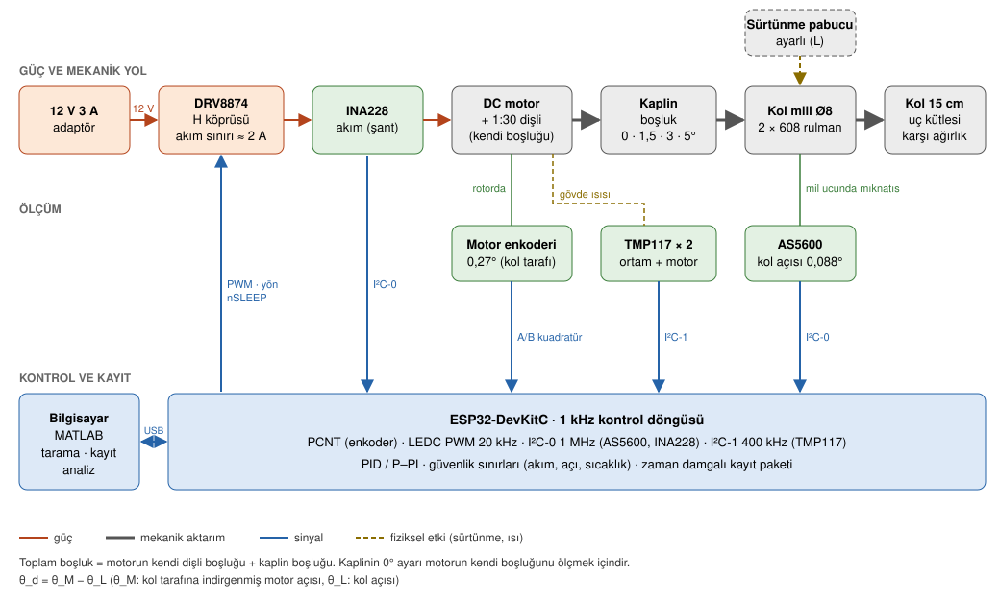
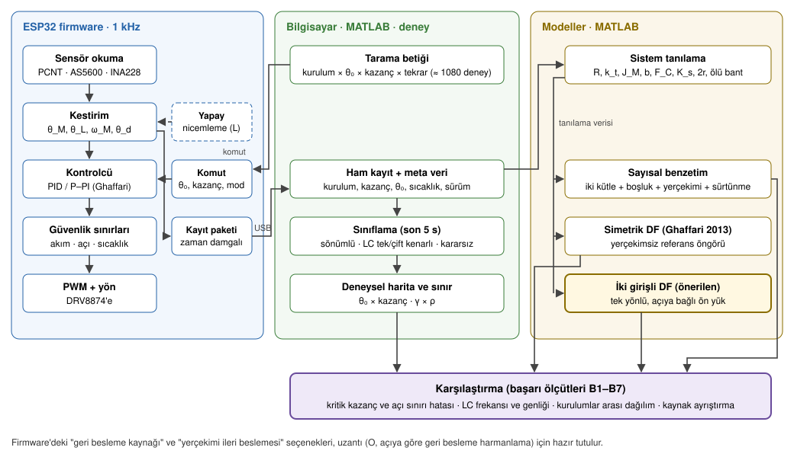

# Donanım ve yazılım planı (taslak)

Çalışma notunun 2. aşaması. Framing'den türetilmiştir (`framing.md`). Her bileşenin hangi araştırma ihtiyacından doğduğu "Neden" sütunlarında yazılıdır. Parça seçimlerinin ayrıntısı `../donanim/tasarim_kararlari.md` belgesinde; model, adet ve fiyatlar 3. aşamada (malzeme listeleri).

## 1. Framing'in donanımdan istedikleri

| Araştırma ihtiyacı | Donanım ve yazılım karşılığı |
|---|---|
| Sınırı θ₀ × kazanç düzleminde ölçmek (B1, B2) | Mutlak kol açısı sensörü; yazılımla değiştirilen kazanç; otomatik tarama betiği |
| Salınımın boşluktan geldiğini göstermek (θ_d) | İki sensör: motor enkoderi ve kol açısı; θ_d = θ_M − θ_L (θ_M kol tarafına indirgenmiş motor açısı, yani rotor açısı / N) |
| Üç farklı kurulum (B4) | Değiştirilebilir uç kütlesi; ayarlanabilir boşluklu kaplin (0 / 1,5 / 3 / 5°; 0° motorun kendi boşluğunu ölçmek için) |
| Ghaffari ile birebir karşılaştırma (B1) | Yazılımda seçilebilir iki kontrolcü: PID ve Ghaffari'nin P–PI yapısı |
| Kaynak ayrıştırma (L, B5) | Ayarlanabilir sürtünme pabucu; yazılımda yapay nicemleme (bit atma) |
| Dengeleme (H, B7) | Kolun milin öbür tarafına uzantısı ve karşı ağırlık |
| Tekrarlanabilirlik ve belirsizlik (B6) | Motor akımı ve sıcaklık kaydı; döngü zamanlaması kaydı; aynı motor sıcaklığında başlatma |
| Model parametreleri | Sistem tanılama deneyleri: R, k_t, J_M, b, F_C, K_s, 2r, ölü bant |

## 2. Sistem mimarisi (donanım ve sinyaller)



**Bileşenler ve gerekçeleri**

| Blok | Seçim (dengeli liste) | Görev | Neden |
|---|---|---|---|
| Motor | JGB37-520 12 V 1:30 enkoderli | Tahrik; dişli kutusu boşluğun bir kaynağı | Simülasyon bu sınıfla yapıldı; tork sınırı nedeniyle ω_c ≈ 30–45 rad/s (`simulasyon/motor_jgb37.m`) |
| Sürücü | DRV8874 | PWM'i motor gerilimine çevirir; donanım akım sınırı | Durma akımı (2,3 A) TB6612'nin sınırının üstünde; akım sınırı salınım deneylerinde motoru korur |
| Besleme | Mean Well 12 V 3 A | Motor gücü | Dalgalanması düşük; ucuz adaptörün dalgalanması doğrudan torka biner |
| Kontrol birimi | ESP32-DevKitC | Kontrol döngüsü, sensör okuma, veri akışı | Donanım enkoder sayacı, 20 kHz PWM, tek duyarlıklı FPU; 1 kHz için yeterli |
| Motor tarafı ölçüm | Motor enkoderi (kuadratür) | θ_M; türev terimi için hız | Kol hızından türev almak döngüyü kararsızlaştırıyor (simülasyon) |
| Kol tarafı ölçüm | AS5600 + diametral mıknatıs, filtre SF = 11 | θ_L (mutlak); konum geri beslemesi; θ_d | Mutlak açı: her deneyde θ₀ yeniden bulunur. Varsayılan filtre 2,2 ms gecikme verir; SF = 11 ile 0,286 ms |
| Akım | INA228 (I²C-0) | Tork kestirimi (k_t·i); ısınma ve doyum izleme | Salınım deneylerinde akım RMS'i sınırlayıcı |
| Sıcaklık | TMP117 × 2 (ayrı hat I²C-1, 400 kHz) | Sargı direnci ve sürtünme sıcaklığa bağlı | Tekrarlanabilirlik (B6). TMP117 en fazla 400 kHz destekler, bu yüzden hızlı hatta değil |
| Mekanik | Ayarlanabilir kaplin, Ø8 çelik mil, 2 × 608 rulman, gövde, kol, ağırlıklar, sürtünme pabucu | Boşluk, yerçekimi ve sürtünme düğmeleri | Framing'in üç bağımsız düğmesi: 2r, mgℓ, F_C |

**Toplam boşluk** = motorun kendi dişli boşluğu + kaplin boşluğu. Motor boşluğu, kaplinin 0° (boşluksuz) parçasıyla sistem tanılamada ölçülür; diğer kaplin ayarları bunun üstüne eklenir. Ucuz bir dişli kutusunun kendi boşluğu 1–3° olabilir. Bu durumda en küçük toplam boşluk motorunkiyle sınırlı kalır ve kurulumlar "motor + 1,5 / 3 / 5°" olarak raporlanır.

### Elektrik bağlantıları ve güvenlik

- **Ortak toprak:** adaptörün eksi ucu, DRV8874 GND ve ESP32 GND tek noktada birleşir. USB toprağı da bilgisayar üzerinden bu noktaya bağlanır; toprak döngüsünü önlemek için kablolar kısa ve yıldız bağlantılı tutulur.
- **Enkoder beslemesi:** Hall enkoder 3,3 V ile beslenir, böylece çıkışları doğrudan ESP32'ye girer. 3,3 V'ta çalışmazsa 5 V ile beslenir ve çıkışlara seviye çevirici eklenir. Bu durum veri sayfası ya da ölçümle doğrulanacak.
- **I²C hatları:** I²C-0 (AS5600, INA228) 1 MHz, I²C-1 (TMP117 × 2) 400 kHz. Adafruit kartlarındaki çekme dirençleri iki hatta ayrı ayrı kontrol edilir; hızlı hatta kablo kısa tutulur.
- **Motor beslemesi:** DRV8874'ün VM girişine, kartın önerdiği şekilde ek elektrolitik kondansatör. Akım sınırı kartın direnciyle ≈ 2 A'e ayarlanır.
- **Acil durdurma:** 12 V hattında elle kesilebilen bir anahtar (yazılımdan bağımsız). Yazılım tarafı: akım, açı, sıcaklık sınırları ve iletişim kesilince motoru durdurma.
- **Pin planı** 5. aşamada (donanım hazırlığı) çıkarılacak.

## 3. Mekanik yapı

```
  yan görünüş (kol düşey düzlemde döner)

   [motor + 1:30 dişli]──(kaplin: dil + yuva, 0/1,5/3/5°)──[mil Ø8]══(rulman)═══(rulman)══[mıknatıs] ⟶ AS5600
                                                             │
                                                     [sürtünme diski + keçe pabuç, vidayla ayarlı]
                                                             │
                                          karşı ağırlık ◄────┼────► kol 15 cm ──► uç kütlesi (0/20/50 g)
```

- **Kaplin:** motor milinden (6 mm D) kol miline (Ø8). Dil ve yuva arasındaki açısal boşluk, değiştirilebilir 3B baskı parçalarla 0 / 1,5 / 3 / 5°.
- **Kol mili:** iki 608 rulmanla gövdeye yataklanır. Kol yükünü motor milinden ayırır, böylece motorun kendi yatakları eğilme yükü taşımaz.
- **AS5600:** milin ucunda, mıknatısla eksenel hizada. Kalibrasyon: birkaç açıda motor enkoderine göre (boşluk bir yöne bastırılı tutularak).
- **Kol:** alüminyum lama; uçta vidalı ağırlık yuvası, milin öbür tarafında karşı ağırlık yuvası (H).
- **Sürtünme pabucu:** mile bağlı bir disk ve ona vidayla bastırılan keçe pabuç. Sürtünmeyi açıdan bağımsız olarak ekler (L senaryosu).
- **Güvenlik:** 0° altı ve 180° üstüne geçişi önleyen mekanik durdurucu; yazılımda açı sınırı.

## 4. Yazılım mimarisi



### 4.1 Firmware (ESP32)

| Görev | Ayrıntı |
|---|---|
| Döngü | 1 kHz, donanım zamanlayıcısıyla. Kontrol bir çekirdeğe sabitlenir, Wi-Fi kapalı. Döngü süresi ve gecikmesi her pakete yazılır. |
| Okuma | Enkoder: PCNT (gürültü filtresi açık; 16 bit sayaç taşması yazılımda izlenir). AS5600: I²C-0 1 MHz, her döngüde; açılışta SF = 11, FTH kapalı yazılır. INA228: I²C-0, dönüşüm süresi ve ortalama sayısı 1 kHz'e göre ayarlanır, her döngüde ya da 500 Hz. TMP117: I²C-1 400 kHz, 10 Hz. |
| Kestirim | θ_M (kol tarafına indirgenmiş), θ_L, ω_M (ayrık türev + 1. derece filtre), θ_d = θ_M − θ_L |
| Kontrolcü A: PID | u = K_p e + K_i ∫e − K_d ω_M; e = θ₀ − θ_L. Kazançlar ω_c'den: K_p = J ω_c², K_d = 1,4 J ω_c, K_i = K_p ω_c / 4 (simülasyonla aynı). |
| Kontrolcü B: P–PI | Ghaffari 2013 yapısı: dış konum döngüsü (k_p), iç hız döngüsü (k_v, T_i), hız motor enkoderinden. Ghaffari'nin r_gs tanımıyla birebir karşılaştırma için. |
| Seçenekler | Yerçekimi ileri beslemesi açık/kapalı; geri besleme kol ya da motor açısından (O uzantısı için hazır); yapay nicemleme (L). Not: ileri besleme dişliden geçen torku değiştirmez (yerçekimi yükü yine dişliden taşınır), yani doğal ön yük yok olmaz; yalnız integral teriminin yükünü alır. Bu yüzden ana deneylerde kapalı tutulur, etkisi ayrıca denenir. |
| Güvenlik | Yazılım akım sınırı (DRV8874'ün donanım sınırının altında), açı sınırı, motor gövdesi sıcaklık eşiği, iletişim kesilince motoru durdurma |
| Komutlar | θ₀, kontrolcü ve kazançlar, deney süresi, adım genliği, kayıt hızı, mod |
| Kayıt paketi | Zaman damgası, θ_M sayımı, θ_L ham, akım, PWM görev oranı, döngü süresi; sıcaklıklar 10 Hz. ≈ 20 bayt × 1 kHz ≈ 20 kB/s (921600 baud ≈ 92 kB/s'nin altında). |

### 4.2 Deney ve veri toplama (bilgisayar)

Bilgisayar tarafı MATLAB'da yazılır (`serialport` ile seri haberleşme). Simülasyon ve analiz zaten MATLAB'da; ayrı bir dil kurulmaz.

- **Tarama betiği:** her (kurulum, θ₀, kazanç, tekrar) için:
  1. Kolu θ₀ − 5°'ye götürür.
  2. Adım komutunu verir.
  3. 10 s kayıt alır.
  4. Motoru bekletir; sıcaklık başlangıç değerine dönünce bir sonraki deneye geçer.

  Bir deney ≈ 15–30 s olduğundan 1080 deney yaklaşık 5–9 saatlik otomatik çalışma eder; birkaç oturuma bölünür.
- **Meta veri:** her dosyada kurulum (uç kütlesi, kaplin boşluğu, sürtünme pabucu, karşı ağırlık), kontrolcü, kazançlar, θ₀, sıcaklıklar, firmware sürümü.
- **Sınıflama (otomatik, son 5 s):** salınım yok ya da sönümlü / tek kenarlı LC / iki kenarlı LC / kararsız ya da doyum. Ölçütler: θ_L genliği, θ_d'nin boşluk kenarlarına değip değmediği, baskın frekans, akım doyumu. Simülasyondaki sınıflarla aynı tanımlar.
- **Sınır çıkarma:** her θ₀'da sınıfın değiştiği kazanç aralığı → kritik kazanç ve belirsizlik aralığı.

### 4.3 Modeller

| Model | Amaç | Durum |
|---|---|---|
| Sistem tanılama modelleri: motor elektrik (R, k_t), mekanik (J_M, b, F_C), dişli teması (K_s), boşluk (2r), sürücü ölü bandı | Benzetim ve DF parametreleri | Deney tarifleri literatürde (Yamada 2016, Malik 2009) |
| Sayısal benzetim: iki kütle + boşluk + yerçekimi + Stribeck sürtünmesi + nicemleme + ayrık zaman + sensör gecikmesi (AS5600 filtresi 0,286 ms ve I²C okuma süresi) | "Kesin" referans; rejim ayrımı | Var (`simulasyon/`); tanılanan parametrelerle ve sensör gecikmesiyle güncellenecek |
| Ghaffari / simetrik DF | Yerçekimsiz referans öngörü (B1'deki karşılaştırma) | 4a'da yeniden üretilecek |
| İki girişli DF | Önerilen öngörü | 4b'de türetilecek |
| Kesin parçalı doğrusal çözüm (Kollár / Esbrook yöntemi) | DF'nin bozulduğu rejimde referans | Gerekirse |

### 4.4 Kontrol yöntemleri

- **Ana deneyler:** sabit kazançlı PID ve P–PI. Amaç kontrolcüyü iyileştirmek değil, sınırı ölçüp öngörmek.
- **Referans karşılaştırma:** aynı veri üzerinde yerçekimsiz Ghaffari öngörüsü ve önerilen öngörü.
- **Uzantı (ana katkı tuttuktan sonra):** açıya göre geri besleme harmanlama (O). Firmware'deki "geri besleme kaynağı" seçeneği buna hazır.

## 5. Kalibrasyon ve alt sistem testleri (5c aşamasının özeti)

1. Enkoder yönü ve sayım/tur doğrulaması (kol tarafında 1320).
2. AS5600 yapılandırması (SF = 11, FTH kapalı) okunarak doğrulanır; sıfırı ve doğrusallığı dişli bir yöne bastırılı tutularak motor enkoderine göre birkaç açıda.
3. INA228 kalibrasyonu: bilinen dirençle; DRV8874 CS çıkışıyla çapraz kontrol.
4. Boşluk ölçümü: θ_d'nin iki kenarı arasındaki fark, birkaç açıda (Yamada 2016 tarifi); önce kaplin 0° ile motorun kendi boşluğu, sonra her kaplin ayarı.
5. Ölü bant ve sürtünme: yavaş rampa ve tek yönlü sabit hız deneyleri.
6. J_M, b: adım ve serbest yavaşlama yanıtı (kol sökülü ve takılı).
7. K_s: kol bastırılı tutulup küçük tork adımlarıyla.
8. Döngü zamanlaması: 1 kHz'te titreşim (jitter) ve I²C süresi ölçümü.
